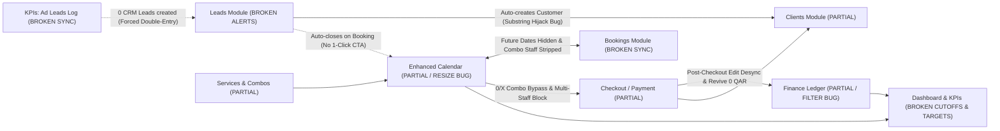

# Laleen CRM — Complete 7-Module End-to-End Human Workflow QA & Business-Logic Audit Report

**Audit Date:** 2026-11-16  
**Modules Audited End-to-End:** `Leads` · `Bookings` · `Enhanced Calendar` · `Finance` · `Clients` · `Services` · `KPIs` (including `/dashboard`)  
**Audit Mode:** Strictly Read-Only Swarm Simulation (Laravel HTTP Kernel + Authenticated Role Sessions + Live SQLite Sandbox Clones)  
**Database Integrity Attestation:** `database/database.sqlite` SHA-256 `24AE9067A10C9C48D88C381A4AB955447494D57F4CD1A70D6874CFDF093F41FC` (100% unchanged before & after audit)

---

## Table of Contents
1. [Section 1 — End-to-End Flow Scorecard (7 Modules & All Handoffs)](#1-end-to-end-flow-scorecard)
2. [Section 2 — Master Catalog of Confirmed Bugs & Broken Handoffs (All P0, P1 & P2 Findings)](#2-confirmed-bugs--broken-handoffs)
3. [Section 3 — Financial, Combo, Phone-Matching, Timezone & Attribution Logic Gaps](#3-financial-combo--attribution-logic-gaps)
4. [Section 4 — Human UX & Busy-Hour Salon Friction Points](#4-human-ux--process-friction)
5. [Section 5 — Prioritized Fix Roadmap (`P0 Critical`, `P1 Important`, `P2 Nice-to-Have`) & Open Policy Decisions](#5-prioritized-fix-roadmap)
6. [Appendix A — Full Unabridged Report: Agent 1 (`lead-flow`: Chat Agent & Marketing Lead Flow)](#appendix-a--agent-1-lead-flow-full-audit-report)
7. [Appendix B — Full Unabridged Report: Agent 2 (`floor-sched`: Reception & Floor Scheduling)](#appendix-b--agent-2-floor-sched-full-audit-report)
8. [Appendix C — Full Unabridged Report: Agent 3 (`checkout-fin`: Cashier, Revenue Integrity & Client History)](#appendix-c--agent-3-checkout-fin-full-audit-report)
9. [Appendix D — Full Unabridged Report: Agent 4 (`kpi-audit`: Cross-Module Attribution & KPI Math)](#appendix-d--agent-4-kpi-audit-full-audit-report)
10. [Appendix E — Full Unabridged Report: `qa-verifier` (Independent Line-by-Line Code & Sandbox Verification)](#appendix-e--qa-verifier-independent-verification-verdict)

---

## 1. End-to-End Flow Scorecard

### 1.1 Module-Level Status Summary

| # | Module | Overall Status | Core Strengths Verified | Critical & High-Impact Failures Found |
| :-: | :--- | :---: | :--- | :--- |
| **1** | **`Leads`** | **Broken** | `+974` & ~245 global dial codes (`<x-country-code-picker>`), open-lead deduplication/merging, single & combo `Service Interest` pills. | **P0:** Cancelled bookings (`category = 'cancel'`) with due/overdue follow-up dates vanish from **every** alert queue (Bell, Sidebar pill, Pending filter, Overdue pill, Needs Follow-up Date) — even after checking `Follow up`. **P1:** `Edit Lead` silently drops `Customer Name` changes; role-scoped Bell (`1`) contradicts unscoped Morning Brief (`Due Today: 5 · Overdue: 3`) on the same screen; unassigned leads (`assigned_agent_id = NULL`) are invisible to all chat agents; zero `branch` or `source` UI fields. |
| **2** | **`Services`** | **Partial** | Service & Combo CRUD, automatic `propagateServiceRename()`, active `ClientPackage` pool deletion protection. | **P2:** `ComboController::validated()` ignores `default_duration` (cannot set 90m/120m hold for `0/X` combos); `New Service` hides `Team members (0)` in a secondary tab with no branch badges (`Old Airport` vs `Al Wakrah`) and allows saving `0`-staff services that fail `missing_skill` everywhere. |
| **3** | **`Enhanced Calendar`** | **Partial** | General `Decide in Salon` (`60m` hold, `0.00 QAR`, auto-closes open `Lead` to `booked`, blocks premature checkout); upfront Combo nested `←` sub-picker (`Today`-only grid block duration + locked combo QAR price); centralized `BookingConflictValidator` (`staff_off`, `staff_busy`, `outside_branch_hours`, `cross_branch`). | **P0:** Resizing/dragging multi-service Day-view slices crushes sibling service durations (`60m -> 15m`) and shifts parent start times. **P0:** Multi-stylist standalone bookings (`Hair Color` + `Pedicure`) fail `422 missing_skill` both on creation and via drawer `+ Add service`. **P1:** `StaffBlock` allows blocking directly over active client bookings; `Client Notes`, `Appointment Notes`, and `BOOKING AGENT` are invisible/uneditable in `#apptDrawer`; 12-country hardcoded `<select>` in `Add New Client` lacks `+962` & 225+ countries. |
| **4** | **`Bookings`** | **Broken** | Canonical branch normalization (`Al Wakrah` / `Wakrah` / `al_wakrah` -> `'wakrah'`) on main table query; custom line-discount audit logging (`appointment_price_overrides`). | **P0:** `This Month` (default), `This Week`, and `All Time` cap `$to` at `today 23:59:59`, hiding **100% of future appointments**. **P0:** Paid (`Completed`) bookings remain editable without updating `sales` (desyncing branch/price/staff/client and re-unlocking paid Combo slots!). **P1:** Editing a multi-stylist Combo strips `service_staff` (`422 missing_skill`); Unscheduled Queue rows display `12:00 AM` and fail `422 outside_branch_hours` on edit; editing Visit 2 redemption shows `350 QAR` and clones duplicate `is_pending` rows. |
| **5** | **`Finance` & `Checkout`** | **Broken** | General `Decide in Salon` checkout block holds across all 5 routes; clean-path Combo Visit 1 (`200 QAR`) + Visit 2 (`0 QAR`) cash-basis works; `downstreamPackageRedemptionConflict()` blocks (`422`) cancelling Visit 1 once Visit 2 redeems a slot. | **P0:** Cancelling/no-showing a Combo & rescheduling deletes `ClientPackage` while keeping 100%-discounted `0 QAR` service rows — checking out the revived Combo for **`0.00 QAR`**. **P0:** `0/X` unpicked Combos bypass `isUnresolvedDecideInSalon()`, checking out with `0` slots redeemed (`3/3` free slots banked). **P0:** Users with `finance: none` can hard-delete paid `Sale` rows via status/delete. **P1:** Visit 2 standalone + checkout redemption double-charges (`150 QAR` + burns credit); out-of-stock retail products sell freely and create phantom stock on cancel; staff filter subtracts 100% of branch expenses on `Overview` while hiding the staff filter chip. |
| **6** | **`Clients`** | **Partial** | Canonical phone matching on fresh `+974` & international creation; net LTV (deducting discounts, excluding tips) and completed-only visit counts on standard flows. | **P0:** `CustomerController@lookup` falls back to `LIKE '%8digits%'`, hijacking international profiles (e.g., KSA `966558811223`) during Qatar `Add Lead` (`55881122`). **P1:** Future `'confirmed'` / `'arrived'` bookings drop out of `Upcoming` into `Past Appointments`; `no_show` appointments pollute branch filters & badges on `customers.index`; `Rebook Favorite Visit` pre-fills paid standalone services instead of `Redeem Package`; tips inflate loyalty points. |
| **7** | **`KPIs` & `/dashboard`** | **Broken** | Server PHP defaults to `Asia/Qatar`; same-month single-stylist chair upsell tracking works. | **P0:** SQLite lexical `whereBetween('date', ..., toDateString())` drops **100% of `$to`-day `AdLeadEntry` & `KpiChatEvaluation` rows** on `/dashboard`. **P0:** Ahana/Rhea `Chair Upsells` reads nonexistent `prorated_team_target`, dividing branch team quota down to 1 stylist (`907 QAR` instead of `3,510` / `2,632 QAR`). **P0:** `#bookAgent` defaults blank & is uneditable post-create (`+0` quota); Wakrah stylist `Nadia` (`role='agent'`) inflates Laden's Team Bookings (`15` vs `13`) while dropping out of Wakrah Salon Staff Evals (`2` vs `3`); `/kpis` divides `daily_avg_pace` by `30` instead of `daysElapsed`. |

### 1.2 Cross-Module Handoff Scorecard

| Handoff Path | Verdict | Summary of Handoff Behavior |
| :--- | :---: | :--- |
| **`KPIs -> Ad Leads Log` -> `Leads`** | **Broken** | `0` CRM `Lead` rows created (`ad_lead_entries.lead_id` is always `NULL`); `Lead::isPaidAdLead()` & `AdLeadEntry::resolveCategoryFromLead()` have `0` callers. Requires 100% manual double-entry. |
| **`Leads` -> `Clients` (`customers`)** | **Partial** | Auto-creates canonical `Customer` on fresh numbers, **except** cross-country `LIKE '%8digits%'` hijack in `lookup()`, legacy `+974` duplicates on fast submit, and dropped `Customer Name` edits in `Edit Lead`. |
| **`Leads` -> `Enhanced Calendar` / `Bookings`** | **Partial** | Booking auto-closes open `Lead` (`needful_done = 'booked'`, `next_followup_date = null`), **but** there is no 1-click `"Book"` CTA on `Leads`, `#bookAgent` defaults blank, and cancelling the booking drops the `Lead` into an invisible `cancel` blind spot (`0` follow-up alerts). |
| **`Enhanced Calendar` <-> `Bookings`** | **Broken** | `Bookings` hides all future dates (`> today`) on default `This Month`/`This Week`/`All Time`, strips per-service Combo stylists on edit (`422`), rejects Unscheduled Queue edits (`422`), and splits `calendar` vs `bookings` permissions. |
| **`Enhanced Calendar` / `Bookings` -> `Checkout` -> `Finance`** | **Broken** | Clean single-pass checkouts reconcile, **but** `0/X` Combos bypass checkout block, cancelled+rescheduled Combos check out at `0.00 QAR`, post-checkout edits in `Bookings` desync `appointments` from `sales` & re-unlock Combo credits, and `finance: none` users can wipe out paid `Sale` rows. |
| **`Bookings` / `Finance` -> `KPIs` & `/dashboard`** | **Broken** | Unpaid Calendar bookings wipe manual `AdLeadEntry` branch/ticket; Oct 31 -> Nov 1 ad checkouts get `0 QAR`; pre-booked organic visits get hijacked by later Ad Leads; `/dashboard` drops `$to`-day Ad Leads & Chat Evals, miscalculates Branch Upsell targets, and links Rhea's Wakrah card to Old Airport (`/kpis/staff-sales?branch=wakrah`). |

---

## 2. Confirmed Bugs & Broken Handoffs

### 2.1 `P0 Critical` Bugs (13 Verified Critical Issues)

#### **[P0-1] Editing a Checked-Out (`Completed`) Booking Desynchronizes `Appointment` vs `Sale` & Re-Unlocks Redeemed Combo Slots**
- **Files & Lines:** `app/Http/Controllers/AppointmentController.php` (`update()` L803–1312, `persistComboPackageSelection()` L1190–1192 & L3894–3988, `reschedule()` L3042–3211, `addService()` L3348, `updateService()` L3410, `destroyService()` L3539, `addUpsell()` L4172); `resources/views/appointments/index.blade.php` L872–878.
- **Human Reproduction Steps:**
  1. Complete checkout on a `200 QAR` booking at `Old Airport` with `Staff #1` (`Sale` created: `branch='old_airport'`, `total_amount=200`, `staff_id=1`).
  2. Open `Bookings` (`/appointments`), click **Edit** on that `Completed` row, change Branch to `Al Wakrah`, Service to `Balayage (320 QAR)`, Staff to `Staff #7`, or Customer phone, and click **Save changes** (`PUT /appointments/{id}`).
  3. Repeat on a paid `3/3` completed Combo booking: open `Bookings -> Edit`, click the Combo card, uncheck 2 `Today` services, and click **Save changes**.
- **Actual Behavior:**
  - `PUT /appointments/{id}` returns `HTTP 200`: `appointments.branch` becomes `'wakrah'`, `appointments.price` becomes `320`, `appointments.staff_id` becomes `7`, and `appointments.customer_id` changes — while `sales` remains frozen at `old_airport` / `200 QAR` / `Staff #1` / old `customer_id`! `Bookings` and `AdLeadEntry` (`AdLeadEntry.php` L704) report `Al Wakrah`, `Finance` reports `Old Airport`, and `Clients` LTV stays stuck on the old customer.
  - Worse: unlike `updateComboServices()` (which guards paid bookings at L3622), `update()` executes `persistComboPackageSelection()` on an already-paid combo, deleting `ClientPackageService` rows (`sale_items.client_package_service_id` becomes `null`) and flipping a `completed (3/3)` package back to `active (1/3 redeemed, 2/3 free remaining)`!
- **Expected Behavior:** Lock financial, service, combo, branch, staff, and customer mutations whenever `$appointment->sale()->exists()` across `update`, `reschedule`, `addService`, `updateService`, `destroyService`, and `addUpsell` unless an authorized manager void/re-checkout flow is executed.

#### **[P0-2] Cancelling or No-Showing a Combo Booking & Rescheduling Turns It Into a `0.00 QAR` Freebie**
- **Files & Lines:** `app/Http/Controllers/AppointmentController.php` (`reverseAppointmentSale()` L1496–1570, `update()` L1094–1096 & L1193–1205, `updateStatus()` L2607–2609); `app/Models/Appointment.php` (`syncFromServices()` L276–280); `resources/views/appointments/calendar.blade.php` L4061–4070.
- **Human Reproduction Steps:**
  1. Book a `200 QAR` or `350 QAR` Combo (`Bridal Glow Package`, e.g., `Haircut` + `Manicure` today).
  2. Click `Quick actions -> Cancel` or `No show` in the Calendar drawer (fires immediately with zero confirmation dialog).
  3. Client calls back 5 minutes later to reschedule: open `Bookings -> Reschedule`, set a new time and `Status = Pending`, save, and open **Checkout**.
- **Actual Behavior:** `reverseAppointmentSale()` permanently deletes the `ClientPackage` row (`L1518–1521`) and any `Sale` (`L1561`), **but leaves the combo's 100%-discounted `AppointmentService` rows (`discount_type='percent'`, `discount_value=100`, `final_price = 0.00 QAR`) attached**. Reviving sets `appointments.price = 0.00 QAR` (`unpaidPackagesTotal = 0 + activeLinesTotal = 0`), allowing the cashier to check out the entire Combo visit for **`0.00 QAR`** with `0` pending package slots banked!
- **Expected Behavior:** Either strip combo-discounted `AppointmentService` rows (reverting to `Decide in Salon` / requiring combo re-selection) when deleting an originating `ClientPackage`, or recreate/preserve the unpaid `ClientPackage` when reviving a cancelled combo; add confirmation modals to drawer `Cancel` / `No show`.

#### **[P0-3] Staff With `finance: none` Can Silently Hard-Delete Paid `Sale` & Cash Revenue Records**
- **Files & Lines:** `routes/web.php` L169–181 vs L192–200; `app/Http/Controllers/AppointmentController.php` (`reverseAppointmentSale()` L1559–1561, `updateStatus()` L2607–2609, `destroy()` L1337, `update()` L1094–1096).
- **Human Reproduction Steps:** Log in as a user with `bookings: edit` and `finance: none`. Visiting `GET /appointments/{id}/payment` rightly returns `403`, **but** sending `PATCH /appointments/{id}/status` (`cancelled` / `no_show`), `PUT /appointments/{id}`, or `DELETE /appointments/{id}` on a paid `Completed` booking succeeds (`HTTP 200`/`302`).
- **Actual Behavior:** Permanently hard-deletes paid `Sale`, `SaleItem`s, and `SalePayment`s from `Finance` with zero `canEdit('finance')` check and zero void/refund audit log.
- **Expected Behavior:** Require `canEdit('finance')` (or Admin role) whenever reversing/deleting an appointment that has a recorded `Sale`, and write an immutable audit/void entry.

#### **[P0-4] Unpicked `0/X` Combo ("Choose in Salon") Bypasses Checkout Guardrail — Completes Visit With `0` Slots Redeemed**
- **Files & Lines:** `app/Http/Controllers/AppointmentController.php` (`isUnresolvedDecideInSalon()` L4240–4259, `payment()` L4268, `storePayment()` L4442–4451); `resources/views/appointments/calendar.blade.php` L3708–3713; `resources/views/appointments/index.blade.php` L840, L864.
- **Human Reproduction Steps:** Book `Bridal Glow Package (200 QAR)` -> click *"Skip selection — Decide services in salon"* (`0 / 3 Selected`, `service_name = 'Choose in Salon'`, `is_combo_tbd = true`). Click **Checkout** -> **Full amount to cash (200 QAR)** -> **Complete Sale** without selecting any performed services.
- **Actual Behavior:** `isUnresolvedDecideInSalon()` returns `false` whenever `combo_name` (L4246) or `ClientPackage` (L4254) exists. Checkout completes with `status = 'completed'`, `service_name = 'Choose in Salon'`, `0` staff service attribution, and **`3 / 3` free sessions still remaining** on the client's package — giving away an extra free service if reception forgot to select today's performed item(s)!
- **Expected Behavior:** Block checkout on `is_combo_tbd` (`0` services selected today) unless at least `1` service is selected for today OR an explicit *"Package Pre-Purchase Only (0 services performed today)"* confirmation is checked.

#### **[P0-5] `Bookings` (`This Month`, `This Week`, `All Time`) Silently Hides 100% of Future Appointments After Today**
- **Files & Lines:** `app/Http/Controllers/AppointmentController.php` (`resolvePeriod()` L102–120, L149).
- **Human Reproduction Steps:** Book an appointment on `Enhanced Calendar` for 3–7 days ahead (`2026-11-23` when today is `2026-11-16`). Open `Bookings` (`/appointments`, which defaults to `This Month`), or switch to `This Week` or `All Time`, and search the client's name or phone.
- **Actual Behavior:** Returns `"No bookings in this date range"` (`0` rows)! `resolvePeriod()` caps `$to` at `$now->copy()->endOfDay()` on `this_week` (L110), `all_time` (L116), and default `this_month` (L118). Receptionists believe future appointments were lost unless they manually pick `Custom Range` (or `Tomorrow` for `+1d`).
- **Expected Behavior:** Span `this_week` through `endOfWeek()`, `this_month` through `endOfMonth()`, and leave `$to` unbounded on `all_time`.

#### **[P0-6] Day-View Multi-Service Drag & Resize Crushes Sibling Service Durations & Shifts Whole-Appointment Start Times**
- **Files & Lines:** `resources/views/appointments/calendar.blade.php` L2527–2540, L4234–4273, L4307–4364 (`onApptResizeStart()`); `app/Http/Controllers/AppointmentController.php` L1859–1867 (`appointmentStaffSlices()`), L2122–2149, L3064–3133 (`reschedule()`).
- **Human Reproduction Steps:** Book a 2-service appointment (`Haircut` 30m `12:00–12:30` + `Facial` 60m `12:30–13:30` = `90m` total). Day view renders two `.cal-appt` slices sharing `data-id="{appointment.id}"`.
  - **Action A:** Drag the bottom resize handle on Slice 1 (`Haircut`) from `30m` to `45m`.
  - **Action B:** Drag the bottom resize handle on Slice 2 (`Facial` at `12:30`) from `60m` to `75m` (or drag Stylist 2's slice to `14:00`).
- **Actual Behavior:**
  - **Action A:** JS sends `duration: 45` (Slice 1's duration) to `PATCH /appointments/{id}/reschedule`. Backend (`L3092–3103`) treats `45` as **total appointment duration**, keeps `Haircut` at `30m`, and **crushes `Facial` from `60m` down to `45 - 30 = 15m`!**
  - **Action B:** JS sends Slice 2's `a.start` (`12:30`) as `appointment_datetime` and `duration: 75` (`calendar.blade.php` L4356). Backend **shifts the entire appointment start from `12:00` to `12:30`** AND **shrinks `Facial` from `60m` to `45m`** (and dragging Stylist 2's slice reassigns Stylist 1's service to Stylist 2!).
- **Expected Behavior:** Bind slice-level resize/drag to `appointment_service_id` (`PATCH /appointments/{id}/services/{lineId}`) so resizing or moving one service slice updates that slice cleanly without corrupting sibling services.

#### **[P0-7] Standalone Multi-Stylist Cross-Skill Bookings Blocked Everywhere (`422 missing_skill`) — Including Drawer `+ Add service`**
- **Files & Lines:** `app/Http/Controllers/AppointmentController.php` (`store()` L417–419 & L524–531, `availableStaff()` L2529–2536, `addService()` L3356–3382); `resources/views/appointments/calendar_book.blade.php` L1008–1016, L2240–2244, L2882; `resources/views/appointments/calendar.blade.php` L2034–2041, L3742–3752.
- **Human Reproduction Steps:**
  1. At `Old Airport`, select `Hair Color` (skilled: `Sara Ahmed`) + `Pedicure` / `Manicure` (skilled: `Aisha Khan`) in `New Appointment`.
  2. Try the 2-step floor workaround: book `Hair Color` alone with `Sara Ahmed`, open `#apptDrawer`, click `+ Add service`, and click `Pedicure`.
- **Actual Behavior:**
  - Step 1: `availableStaff()` requires 1 stylist with `COUNT(DISTINCT service_id) = 2`, returning `[]` (`No available staff`), and `store()` fails `422 missing_skill` because standalone services lack per-service staff selectors.
  - Step 2: `addServiceToAppointment()` posts `{ service_id }` with no `staff_id`; `addService()` (`L3356`) defaults `$assignedStaffId = $appointment->staff_id` (`Sara`) and runs `BookingConflictValidator` *before* creating the row — failing **`422 missing_skill`** immediately!
- **Expected Behavior:** Support per-service stylist selection on multi-service standalone bookings and inside `#drawerServicesAddView` (auto-picking or prompting for an eligible stylist when `$appointment->staff_id` lacks the added service's skill).

#### **[P0-8] Cancelled Leads Vanish Into a Complete Alert Blind Spot Across All Follow-Up Queues (Even When Tagged `Follow up`)**
- **Files & Lines:** `app/Models/Lead.php` (`CATEGORY_PRIORITY` L23–29, `resolvePrimaryCategory()` L218–227, `pendingFollowUpsQuery()` L350–367); `app/Http/Controllers/LeadController.php` (`index()` L34–62, `overdueLeadsQuery()` L953–964, `unscheduledLeadsQuery()` L970–979); `app/Http/Controllers/AppointmentController.php` (`destroy()` L1433–1441, `syncLeadCategoryFromAppointment()` L2902–2950).
- **Human Reproduction Steps:**
  1. Book an appointment for Lead `55123456` (assigned to Agent Areeba `#7`), then cancel or delete the appointment (`syncLeadCategoryFromAppointment` sets `needful_done = NULL`, `category = 'cancel'`, `next_followup_date = today()`).
  2. Open `/leads` and check Left Sidebar `Leads` pill, `🔔 Follow-ups` bell, `Pending Follow-ups` filter, `🔴 Overdue Follow-ups` pill, and `🟠 Needs Follow-up Date` pill.
  3. Edit the Lead (`PUT /leads/{id}`), explicitly check `Follow up` alongside `Cancelled` (`categories = ['cancel', 'follow_up']`), set `Next Follow-up Date` to yesterday, and save.
- **Actual Behavior:** **`0` alerts across every single queue** (confirmed on live DB `Lead #197` too)! `Needs Follow-up Date` excludes it (`next_followup_date` is non-null), while `pendingFollowUpsQuery()` (L359) and `overdueLeadsQuery()` (L54, L962) enforce `where('category', '!=', 'cancel')`. Because `CATEGORY_PRIORITY` orders `no_show > cancel > follow_up`, checking `Follow up` still resolves `category = 'cancel'`, keeping cancelled reschedules permanently invisible!
- **Expected Behavior:** Open (`needful_done NOT IN ['booked', 'no']`) leads with a due/overdue `next_followup_date` must appear in `Pending Follow-ups` and `Overdue Follow-ups` even if previously cancelled (and `follow_up` should take operational precedence when actively scheduled).

#### **[P0-9] Cross-Country Substring Collision Hijacks Qatar `Customer` Profiles During `Add / Edit Lead`**
- **Files & Lines:** `app/Http/Controllers/CustomerController.php` (`lookup()` L1315–1332); `resources/views/leads/index.blade.php` (`handlePhoneChange()` L1520–1559); `app/Http/Controllers/LeadController.php` (`store()` L212, `update()` L327, `resolveOrCreateCustomer()` L1007–1024).
- **Human Reproduction Steps:** Existing KSA client `Hessa Al-Saud` has canonical phone `'966558811223'` (`+966 55 881 1223`). Agent opens `Leads -> Add New Lead`, keeps `+974`, types brand-new Qatar mobile `'55881122'`, waits 400ms, types `'Dana Al-Thani'`, and clicks **Save Lead**.
- **Actual Behavior:** `GET /customers-lookup?phone=55881122` misses exact match and falls back to `Customer::where('phone', 'like', '%55881122%')->first()` (`L1328`), matching Saudi `'966558811223'`! JS sets hidden `customer_id = Hessa` and overwrites `Customer Name`. Even after re-typing `'Dana Al-Thani'`, `resolveOrCreateCustomer()` (`L1012`) blindly trusts `$requestedCustomerId` without checking phone match — linking Dana's Qatar lead onto Hessa's Saudi `Customer` profile!
- **Expected Behavior:** Restrict `CustomerController@lookup` to canonical prefix variants (`AdLeadEntry::buildPhoneLookupSets`), never unbounded substring `LIKE '%8digits%'`, and verify phone match inside `resolveOrCreateCustomer()`.

#### **[P0-10] Zero Two-Way Sync Between `KPIs -> Ad Leads Log` and `Leads` (Forced Human Double-Entry & Dead Sync Helpers)**
- **Files & Lines:** `app/Http/Controllers/Kpi/AdLeadEntryController.php` (`store()` L17–39); `app/Http/Controllers/LeadController.php` (`store()` L191–283); `app/Models/Lead.php` (`isPaidAdLead()` L111–132); `app/Models/AdLeadEntry.php` (`lead_id` L35, `resolveCategoryFromLead()` L439–458).
- **Human Reproduction Steps:** Log an unbooked Instagram ad inquiry (`6611 2233`, `Hair Color`) in `KPIs -> Ad Leads Log -> Add Entry`, then open `/leads` as a Chat Agent. Next, manually add `66112233` in `/leads`.
- **Actual Behavior:** `AdLeadEntryController@store` creates `Customer` + `AdLeadEntry` (`lead_id = NULL`) and **`0` CRM `Lead` rows**; adding a `Lead` later leaves `ad_lead_entries.lead_id = NULL`. `Lead::isPaidAdLead()` and `AdLeadEntry::resolveCategoryFromLead()` have **`0` callers** anywhere in `app/`.
- **Expected Behavior:** Auto-create/merge an open follow-up CRM `Lead` (linking `lead_id`) when an unbooked `AdLeadEntry` is logged, and link/sync paid-ad CRM `Lead`s back to `AdLeadEntry`.

#### **[P0-11] SQLite Lexical Date-Cast Cutoff Drops 100% of `$to`-Day Ad Leads & Chat QA Evaluations on `/dashboard`**
- **Files & Lines:** `app/Support/DashboardScorecardBuilder.php` L386–388 (`buildAyanCard`) & L491–494 (`buildChatAgentCard`); `app/Models/AdLeadEntry.php` L48; `app/Models/KpiChatEvaluation.php`.
- **Human Reproduction Steps:** Log an `AdLeadEntry` or `KpiChatEvaluation` dated today (`2026-11-16`) and open `/dashboard` (`MTD`), OR open `/dashboard?from=2026-11-01&to=2026-11-01` (where live DB already holds `Ad#157 = 2,700 QAR` and `Ad#158 = 1,500 QAR` on `2026-11-01`).
- **Actual Behavior (Verified on Live DB):** Eloquent `'date'` cast writes `'2026-11-01 00:00:00'` in SQLite. `whereBetween('date', [$this->from->toDateString(), $this->to->toDateString()])` compares `'2026-11-01 00:00:00' <= '2026-11-01'` (**false** lexically in SQLite!), dropping **100% of `$to`-day rows** (`Ad Revenue = QAR 0`, `Ad Conversion = 0%` on `/dashboard` vs `100%` on `/kpis`).
- **Expected Behavior:** Use `[$this->from->copy()->startOfDay(), $this->to->copy()->endOfDay()]` (matching `KpiAdsConversionReport::dateRangeBounds()`).

#### **[P0-12] Executive Dashboard Branch Manager `Chair Upsells` Uses Nonexistent Array Key (`prorated_team_target`), Dividing Quota to 1 Stylist**
- **Files & Lines:** `app/Support/DashboardScorecardBuilder.php` L623–632 (`buildBranchManagerCard`) vs `app/Support/StaffSalesAnalytics.php` L224–227 (`summarize`).
- **Human Reproduction Steps:** Open `/dashboard` (`Nov 1–16`) and compare `Ahana (Old Airport)` (4 active stylists) and `Rhea (Al Wakrah)` (3 active stylists) `Chair Upsells` targets against `/kpis/staff-sales`.
- **Actual Behavior (Verified on Live DB):** `StaffSalesAnalytics::totals()` returns `'team_target'` (`3,509.68 QAR` OA; `2,632.26 QAR` Wakrah). `DashboardScorecardBuilder` reads `$upsellTotals['prorated_team_target'] ?? 0.0` (always `0.0`), falling back at L628 to 1 single stylist's target (**`907 QAR`**) — rendering `Ahana: QAR 240 / 907 (26.5%)` instead of `QAR 240 / 3,510 (6.8%)`!
- **Expected Behavior:** Read `$upsellTotals['team_target']` and align month-day proration (`StaffSalesAnalytics::DAYS_IN_MONTH = 31` at L21 vs actual `$daysInMonth`).

#### **[P0-13] Chat Agent Quota Black Hole (`#bookAgent` Blank & Uneditable), Stylist-Login Role Collision (`Nadia`) & `/kpis` Pace Math Bug**
- **Files & Lines:** `resources/views/appointments/calendar_book.blade.php` L1019–1024; `resources/views/appointments/calendar.blade.php` (`#apptDrawer`); `resources/views/appointments/index.blade.php` (`#bookingEditModal`); `app/Models/Staff.php` L130–137; `app/Support/DashboardScorecardBuilder.php` L537; `app/Http/Controllers/Kpi/KpiHubController.php` L779.
- **Verified Reproduction & Impact:**
  1. `#bookAgent` defaults to `""` even when a Chat Agent (`Areeba` / `Zoya`) is logged in, and **neither `#apptDrawer` nor `#bookingEditModal` has a `BOOKING AGENT` input** — any booking saved with blank `BOOKING AGENT` gives `+0` quota and can never be corrected in UI.
  2. Wakrah stylist `Staff #7 Nadia Youssef` is linked to `User #2` (`role = 'agent'`). Because `Staff::salonEvaluatable()` (`Staff.php` L131) excludes `role = 'agent'`, Nadia is **dropped from Wakrah Salon Staff Evaluations** (`2` stylists instead of `3`), while her 6 bookings (`Appt#545..550`) inflate `Laden`'s Team Bookings to **`15`** while `Zoya (6) + Areeba (7) = 13`!
  3. `KpiHubController.php` L779 computes `daily_avg_pace = round($mtdBookings / max(1, $daysInMonth), 1)` (`7 / 30 = 0.2/day`) instead of dividing by `$daysElapsed` (`7 / 16 = 0.4/day`).

---

### 2.2 `P1 Important` Bugs (15 Verified Functional & Revenue-Leak Issues)

1. **[P1-1] Visit 2 Standalone + Checkout Redemption Double-Charge & Credit-Burn Trap (`AppointmentController.php` L4430–4583; `revenue/payment.blade.php` L316–336):**
   - When a client has 1 pending `Facial` slot (or arrives on a `Decide in Salon` hold, since neither `#apptDrawer` nor `#bookingEditModal` has a `Redeem Package` button!) and reception books `Facial (150 QAR)` from regular services, ticking `Redeem Package Services -> Facial` at Checkout adds a second `0 QAR` `Facial` line without zeroing the `150 QAR` line — **charging `150 QAR` AND consuming her remaining package credit (`remaining_count -> 0`)**.
2. **[P1-2] `Bookings` Edit Modal Strips Combo `service_staff`, Shows Misleading `350 QAR` on Visit 2 & Clones `is_pending` Rows (`appointments/index.blade.php` L796–808, L1462–1562; `AppointmentController.php` L557–563, L3810–3815, L3944–3985):**
   - Editing a multi-stylist Combo in `Bookings -> Edit` omits `combo_packages[idx][service_staff]`, failing **`422 missing_skill`** or wiping secondary stylists. Editing Visit 2 (`0 QAR` redemption) displays `350.00 QAR` (`pkg.price_paid`) and clones duplicate `is_pending = true` `AppointmentService` rows onto Visit 2, while Visit 1's `Pending:` chips never clear after Visit 2 redemption.
3. **[P1-3] Unscheduled Queue Bookings Render as `12:00 AM` in `Bookings` & Fail `422 outside_branch_hours` on Edit (`appointments/index.blade.php` L813, L964; `AppointmentController.php` L1028–1123):**
   - `#bookingEditModal` pre-fills `#editTime = "00:00"` (`required`, no `Unscheduled` checkbox), failing `422` (`10:00 AM – 10:00 PM`) on save — or overwriting `start_time = null` with `'00:00:00'` if saved as `Cancelled`.
4. **[P1-4] `reschedule()` Sets `status = 'confirmed'`, Hiding Floor `Mark Arrived` & Dumping Future Visits Into `Past Appointments` (`AppointmentController.php` L838, L3180–3182; `calendar.blade.php` L3106–3109; `CustomerController.php` L469–470):**
   - Reviving a cancelled/no-show booking via `reschedule()` sets `status = 'confirmed'`. `#apptDrawer` only shows `Mark Arrived` when `status === 'pending'`, `#editStatus` in `Bookings` has no `confirmed` option, and `CustomerController@show` requires `status === 'pending'` for `Upcoming` (dumping future `confirmed`/`arrived` bookings into `Past Appointments`).
5. **[P1-5] Deleting Last Redeemed Line on Visit 2 Allows `0.00 QAR` Empty Ghost Sale (`AppointmentController.php` L3545–3569; `Appointment.php` L240–282):**
   - `destroyService()` allows deleting the last line when `combo_name` is set, and `syncFromServices()` leaves `combo_name` non-empty with `price = 0`, letting Checkout record an empty `0.00 QAR` completed `Sale` with `0` items.
6. **[P1-6] Out-of-Stock Retail Products Sold Freely + Deleting/Cancelling Creates Phantom Inventory (`AppointmentController.php` L1550–1557, L4651–4653; `SaleController.php` L45–61, L158):**
   - Selling `3x` of a `0`-stock product clamps `max(0, 0 - 3) = 0`, and cancelling/deleting runs `0 + 3 = 3`, inventing `3` phantom stock units.
7. **[P1-7] Unpaid Calendar Booking Leaves `Ad Leads Log` `"Unbooked"` AND Wipes Manual `Branch` / `Ticket` (`AdLeadEntry.php` L718–728, L828–848; `AppointmentController.php` L610, L5083–5094):**
   - Creating an unpaid `pending` appointment calls `AdLeadEntry::syncFromCustomerActivity()` with `$resetIfNoActivity = true`, wiping manually entered `branch='wakrah'` and `ticket_amount=250` back to `NULL` and `0.00` until paid checkout.
8. **[P1-8] Hard Calendar-Month Attribution Cliff & Pre-Booked Organic Sale Hijack in `AdLeadEntry` (`AdLeadEntry.php` L86, L749–758):**
   - `ATTRIBUTION_WINDOW_DAYS = 30` is unused; an `Oct 31` ad lead who checks out `Nov 1` (24h later) gets **`0.00 QAR`** forever. Conversely, an organic booking created `Oct 5` and checked out `Oct 20` is hijacked as Paid Ad revenue if an ad inquiry arrives `Oct 15`.
9. **[P1-9] Editing `Customer Name` in `Edit Lead` (or Upgrading `'Ad Lead Client'`) Silently Drops the Name Change (`LeadController.php` L1007–1036; `AdLeadEntry.php` L275):**
   - `resolveOrCreateCustomer()` only updates `$customer->name` when the existing name is in `['', 'walk-in', 'guest', 'unnamed', 'unnamed client', '-', '—']` — ignoring real edits in `Edit Lead` AND omitting `'ad lead client'`.
10. **[P1-10] Legacy `+974` Duplicate `Customer` & Unclosed `Lead` Gap (`LeadController.php` L1009–1015; `AppointmentController.php` L731–743):**
    - `LeadController::resolveOrCreateCustomer()` and `autoCloseOpenLeadsForBooking()` only query exact `[$canonicalPhone]` instead of `AdLeadEntry::buildPhoneLookupSets()`, risking duplicate `Customer` rows or unclosed legacy `'+974...'` leads.
11. **[P1-11] Role-Scoping Contradictions, Orphaned Unassigned Leads & No-Access Assignees on `/leads` (`Lead.php` L331–367; `LeadController.php` L47–56, L116, L693–719):**
    - Chat Agent Zoya sees `1` in Bell/Sidebar (scoped) right above `Due Today: 5 · Overdue: 3` in Morning Money Brief (unscoped); unassigned leads (`assigned_agent_id = NULL`, incl. `Lead #195` & retention syncs) are hidden from **all** chat agents; and `User::where('role', 'agent')->get()` lists `Nadia` (`403` on `/leads`) in `Agent Assign`.
12. **[P1-12] Broken Dashboard -> Staff Sales Branch Drilldown (`DashboardScorecardBuilder.php` L730 vs `StaffSalesController.php` L25):**
    - Clicking Rhea's Al Wakrah card opens `/kpis/staff-sales?branch=wakrah`, which `StaffSalesController` ignores (`$request->input('sales_branch', 'old_airport')`), landing on **Old Airport**.
13. **[P1-13] `Finance` Staff Filter Subtracts 100% of Branch Expenses on `Overview` While Hiding Staff Chip (`FinanceController.php` L61–100; `revenue/index.blade.php` L651–968):**
    - Filtering `Sales Ledger` by 1 stylist (`?staff_id=2`) and switching to `Overview` hides `#finHeaderStaffChip` while subtracting 100% of branch expenses from 1 stylist's sales (`Net Profit = -2,580 QAR`), and `Sales Ledger` still prints primary `$sale->staff->name` on multi-staff rows.
14. **[P1-14] Permission Gate Split (`calendar` vs `bookings`) & Null-Permission `403`s (`routes/web.php` L169–186; `calendar.blade.php` L2278, L2701; `User.php` L372–398):**
    - `calendar: edit, bookings: view` omits `#calendarBookModal` (`ReferenceError` on Week click); `bookings: edit, calendar: view` enables drag/resize UI that hits `403` on `/reschedule`; `permissions = null` (`User #2`) maps to `'none'` instead of `ROLE_PERMISSION_PRESETS[$role]`.
15. **[P1-15] `StaffBlockController@store` Allows Blocking Over Active Appointments & Cross-Month Tuesday Staff Evals Vanish (`StaffBlockController.php` L10–34; `KpiHubController.php` L825–829; `DashboardScorecardBuilder.php` L642–646):**
    - `StaffBlock` performs zero overlap check against active bookings; and submitting Monday `Nov 30` staff evaluations on Tuesday `Dec 1` (`evaluation_date = '2026-12-01'`) drops them from **both** November and December KPI scorecards.

---

### 2.3 `P2 Nice-to-Have` Bugs & Polish Items (10 Verified Items)

1. **[P2-1] Enhanced Calendar `"Add New Client"` Country Picker Missing `+962` & 225+ Countries (`calendar_book.blade.php` L1050–1075):** Still uses a hardcoded 12-country `<select>` instead of `<x-country-code-picker>`, and `<x-country-code-picker>` (`L262`) ignores pasted international digits without `+` or `00`.
2. **[P2-2] Client-Side UTC Midnight Date Drift (`12:00 AM–2:59 AM` Doha Time):** `new Date().toISOString().slice(0, 10)` defaults to **yesterday** (and prior month on the 1st) in `kpi/ads/_lead-entry-modal.blade.php` L175, `shifts/config-modal.blade.php` L256/L319, and `staff/index.blade.php` L3421.
3. **[P2-3] Combo Price Substring Collision in `LeadController::resolveServicePrice()` (`L605–649`):** `"[Combo] Haircut & Color Luxury Ritual (450 QAR)"` matches `'haircut'` (`60 QAR`) first, under-pricing pipeline QAR by `390 QAR`.
4. **[P2-4] Loyalty Points Awarded on Tips (`Customer.php` L537–538):** `earnPointsForSale()` uses `$sale->total_amount` (including `tip_amount`), whereas LTV rightly excludes tips.
5. **[P2-5] `No Show` Bookings Pollute `customers.index` Branch Filters & Badges (`Customer.php` L163, L194, L202):** `scopeForBranch` only excludes `cancelled`, not `no_show`.
6. **[P2-6] Cancelling & Rebooking Onto a Different Date Double-Counts Agent Quota (`Appointment.php` L300–355):** `scopeScheduledForAgentQuota` keeps `cancelled` rows and deduplicates by `(agent, customer, appointment_date)`, awarding `+2` credits when a client moves from Nov 3 to Nov 4.
7. **[P2-7] Combo Per-Service Staff Availability Uses Appointment Start Instead of Sequential Slice Offset (`calendar_book.blade.php` L2684–2700):** Checks all `Today` combo services at `14:00` instead of `14:00`, `14:30`, etc.
8. **[P2-8] `ComboController::validated()` Ignores `default_duration` & `Services` Team Tab Lacks Branch Badges (`ComboController.php` L88–115; `services/main-form.blade.php` L215–231).**
9. **[P2-9] Partial Phone Search in `Leads` Filter Prepends Dial Code (`LeadController.php` L83–86):** Filtering `+966` + `'1234'` searches `'9661234'`, missing `'966501234567'`.
10. **[P2-10] Calendar Red `"Now"` Line Jumps Up 10px After 30s (`calendar.blade.php` L2550 `HEADER_H=84` vs L2937 `74`) & Payment Labels Use Generic `Online` Instead of `QPay · Fawran`.**

---

## 3. Financial, Combo & Attribution Logic Gaps

1. **Combo Visit 1 vs Visit 2 Cash-Basis vs Staff Attribution Gap (`ClientPackage.php` L92–95; `FinanceController.php` L263–283):**
   - Unfiltered cash-basis revenue (`200 QAR` on Visit 1, `0 QAR` on Visit 2) is clean, **but** `ClientPackage.price_paid` stores catalog price (`200 QAR`) ignoring checkout discounts (`50 QAR` off -> `150 QAR` net paid), over-attributing **`183.34 QAR`** across Visit 1 + Visit 2 stylists on a `150 QAR` net sale.
   - In live Nov 2026 Old Airport data, unfiltered `grossSales` is **`4,100.00 QAR`**, while summing per-staff `grossSales` across all 4 OA stylists yields **`3,900.02 QAR` (`-199.98 QAR` gap)** from unredeemed combo slots (`Sale#75`, `Sale#78`), while `Sale#77` (`0.00 QAR` redemption receipt) attributes `66.67 QAR` to `Layla Hassan`.
2. **Tips & Cross-Day Checkout Divergences (`FinanceController.php` L97, L114–117, L236; `AppointmentController.php` L149, L175):**
   - On a `200 QAR` service + `30 QAR` card tip: `Gross Sales` = `200 QAR`, Payment Method chip = `230 QAR`, `Sales Ledger -> Total` = `230 QAR` under `All Staff` vs `200 QAR` when staff-filtered.
   - Checking out yesterday's appointment today logs revenue today in `Finance` (`sales.created_at`) vs yesterday in `Bookings` (`appointments.appointment_datetime`).
3. **Multi-Agent Credit Split & Unassigned Queue Retroactive Credit (`AppointmentController.php` L759; `Appointment.php` L303–314):**
   - If Agent A owns the `Lead` and Agent B books the appointment, 1 visit credits **2 agents** (`+1` Lead Conversion to A, `+1` Booking Quota to B).
   - Unassigned/Unscheduled bookings give `+0` quota until assigned a stylist & time, at which point quota credits `appointments.created_at` (yesterday) rather than assignment day.
   - `KpiAgentTargetReport.php` (L43–49 vs L77–125) docblock claims strict `created_by` & shift-window checks, while code ignores `created_by` and buckets unlogged shifts at `14:00`.
4. **Cross-Page KPI Definition & Week-Start Splits:**
   - `/dashboard` scores Branch Managers on 3 KPIs (`50.8%`) and Chat Agents on 3 KPIs (`26.7%`), while `/kpis` scores them on 2 KPIs (`75%`) and 1 KPI (`3.4%`); Overdue Leads shows `4` on `/dashboard` (includes `cancel`) vs `3` on `/kpis` & `/leads` (excludes `cancel`).
   - `Leads`, `Bookings`, `Finance`, and `Staff` start weeks on **Sunday**, while `KPIs`, `/dashboard`, `StaffEvaluation`, and `ContentCalendar` start weeks on **Monday**.
5. **`Wakrah` vs `Al Wakrah` Branch Audit:**
   - `Leads` has zero branch UI (`12/12` rows `branch = NULL`); unbooked `AdLeadEntry` rows have `branch = NULL` (inflating branch conversion `%` on `/kpis/ads`); `/kpis/ads-plan` (`Old Airport` / `Wakrah` Title-Case) has zero ROAS connection to `/kpis/ads`; and exact `where('branch', $branch)` queries in `AppointmentController@$branchStats` (`L186`), `FinanceController` (`L58`, `L185`), `StaffController` (`L62`), `StaffSalesAnalytics` (`L91`), and `LaleenCommandCenterService` (`L472`, `L499`) bypass `Customer::branchMatchValues($branch)`.

---

## 4. Human UX & Process Friction

- **Invisible Floor Context:** `Client Notes`, `Appointment Notes`, and `BOOKING AGENT` are hidden/uneditable in `#apptDrawer` and `#bookingEditModal` (only `customer_allergies` renders on the floor).
- **Missing 1-Click Handoffs:** No `"📅 Book on Calendar"` button on `Leads` or `Ad Leads Log` rows; no `"Redeem Package"` button on `customers.show` (`Rebook Favorite Visit` books paid standalone services instead) or inside `#apptDrawer` / `#bookingEditModal` on existing/`Decide in Salon` bookings.
- **Checkout Redemption UX:** `.redeem-checkbox` on `/payment` allows ticking more services than `remaining_count` before server error and lacks a per-service stylist selector when a secondary stylist performs the redeemed slot.
- **Accidental Destructive Clicks & Missing Floor Controls:** Clicking `Cancel` or `No show` in `#apptDrawer` executes immediately with zero confirmation dialog; no backward status step if `Mark Arrived` is misclicked; no Void/Cancel action on paid drawers in Enhanced Calendar; and `#drawerRescheduleBranch` is hidden so receptionists cannot transfer branches from the calendar drawer.

---

## 5. Prioritized Fix Roadmap

### Tier 1 — `P0 Critical` (Immediate Must-Fix Before Peak Operations)
1. **Post-Checkout & Sale Reversal Locks (`P0-1`, `P0-2`, `P0-3`, `P0-4`):** Guard paid appointments (`$appointment->sale()->exists()`) against price/branch/combo/client edits; require `canEdit('finance')` before reversing any paid `Sale`; clean/recreate combo state on cancel+reschedule so combos never revive at `0.00 QAR`; and block `0/X` `is_combo_tbd` checkouts unless services are picked today (or pre-purchase override is checked).
2. **`Bookings` Future Dates, Day-View Slice Resize & Multi-Stylist Standalone (`P0-5`, `P0-6`, `P0-7`):** Fix `resolvePeriod()` to include future dates in `this_week` / `this_month` / `all_time`; target `appointment_service_id` on Day-view slice resize/drag; and add per-service stylist support to standalone bookings, drawer `+ Add service`, and `Bookings -> Edit` combos (`P1-2`).
3. **`Leads` Cancelled Alert Fix, Phone Lookup Guard & `Ad Leads` Sync (`P0-8`, `P0-9`, `P0-10`):** Surface open cancelled leads with due/overdue follow-up dates across all follow-up queues; eliminate unbounded `LIKE '%8digits%'` in `CustomerController@lookup` + verify phone in `resolveOrCreateCustomer()`; and wire two-way sync between `AdLeadEntry` and `Lead`.
4. **Dashboard & KPI Math Fixes (`P0-11`, `P0-12`, `P0-13`):** Use `endOfDay()` bounds on `/dashboard` (`AdLeadEntry` & `KpiChatEvaluation`); fix `team_target` key on Ahana/Rhea `Chair Upsells`; auto-default `#bookAgent` + make `BOOKING AGENT` editable; separate stylist login role from `agent` (`Nadia`); and divide `/kpis` `daily_avg_pace` by `$daysElapsed`.

### Tier 2 — `P1 Important` (Accounting Precision, Double-Charge Guards & Workflow Sync)
5. **Visit 2 Redemption, Stock & Discounted Package Attribution (`P1-1`, `P1-2`, `P1-5`, `P1-6`):** Add `Redeem Package` to existing/`Decide in Salon` bookings, auto-zero matching standalone lines when redeeming at Checkout, block `0`-item ghost sales, enforce stock/delta tracking on retail products, and record net discounted `price_paid` on `ClientPackage`.
6. **Queue, Status, Notes, Permissions & KPI Edge Cases (`P1-3`, `P1-4`, `P1-7`..`P1-15`):** Support `Unscheduled Queue` in `Bookings -> Edit`; set revived reschedule status to `'pending'` + include `'confirmed'`/`'arrived'` in `customers.show` `Upcoming`; preserve manual `AdLeadEntry` attribution until paid checkout + enable 30-day rolling window & pre-booked organic guard; save `Customer Name` edits in `Edit Lead`; align `calendar`/`bookings` permission gates + null-permission presets; render `Client Notes` & `Appointment Notes` in `#apptDrawer`; prevent `StaffBlock` overlaps with active bookings; fix `?branch=wakrah` Staff Sales link; scope/display staff filter cleanly on `Finance`; and fix cross-month Tuesday `StaffEvaluation` cutoffs.

### Tier 3 — `P2 Nice-to-Have` (UX Speed & Consistency Polish)
7. **Salon Floor & Agent Polish (`P2-1`..`P2-10`):** Mount `<x-country-code-picker>` in Enhanced Calendar's `Add New Client`; add 1-click `"📅 Book on Calendar"` / `"Redeem Package"` CTAs; add drawer `Cancel`/`No show` confirmations; fix `Asia/Qatar` local JS date defaults; fix combo substring pricing in `resolveServicePrice()`; exclude tips from loyalty points; exclude `no_show` from client branch badges; and fix `.cal-now-line` `HEADER_H`.

---
---

## Appendix A — Agent 1 (`lead-flow`) Full Audit Report

@qa-verifier **Agent 1 (`lead-flow`) — End-to-End Chat Agent & Marketing Lead Flow QA Audit Report (`Leads` -> `Clients` -> `KPIs`)**

Sandbox verification completed via Laravel HTTP Kernel (`Illuminate\Contracts\Http\Kernel`) with real authenticated sessions, CSRF tokens, validation, and Blade rendering against isolated `sandbox_lead_flow.sqlite`. Workspace (`git status` / `git diff`) is 100% clean and `database/database.sqlite` SHA256 (`24AE9067A10C9C48D88C381A4AB955447494D57F4CD1A70D6874CFDF093F41FC`) is untouched.

---

### 1. Module & Handoff Scorecard

| Workflow / Handoff Slice | Verdict | Summary |
|---|---|---|
| **1. Manual Lead Creation (`Leads` -> `Add New Lead`) & Role Behavior** | **Partial** | `+974` & ~245 international dial codes (`+962`, `+966`, `+44`), duplicate open-lead merging, and service/combo pills work on creation, **but** `Edit Lead` silently drops `Customer Name` edits, `Agent Assign` lists `leads: none` users, `branch`/`source` have no UI inputs, and combo pipeline QAR collides with substring service names. |
| **2. Automatic `Clients` (`customers`) Creation & Phone Stress Test** | **Partial** | Fresh `+974` (`55123456`, `+97455123456`, `974 5512 3456`, `00974 5512-3456`) and `+966` (`+966 050 123 4567` vs `966501234567`) normalize to canonical digits across all 3 modules, **but** `CustomerController@lookup` has a **P0 cross-country substring hijack bug**, `LeadController` creates duplicate `customers` on legacy `+974` rows, and Enhanced Calendar's country picker is missing `+962` & 230+ countries. |
| **3. `Follow-ups` Bell Badge, Sidebar Pill, Dropdown & Pending Filter** | **Broken** | **P0 blind spot:** Cancelled bookings (`category = 'cancel'`) reopened with `next_followup_date = today()` are excluded from **all** follow-up queues (`Bell = 0`, `Sidebar = 0`, `Pending = 0`, `Overdue = 0`, `Needs Follow-up Date = 0`) — even after manually adding `Follow up`! Plus role-scoped vs global count contradictions on the same `/leads` screen and orphaned unassigned follow-ups. |
| **4. `KPIs -> Ad Leads Log` <-> `Leads`, `Bookings` & `Finance`** | **Broken** | **Zero two-way sync** (`AdLeadEntry` never creates/links a CRM `Lead`, forcing double-entry; sync helpers are dead code); booking an unpaid Calendar appointment leaves `Ad Leads Log` `"Unbooked"` **and wipes out manually entered `branch`/`ticket`**; SQLite `toDateString()` drops today's Ad Leads on `/dashboard`; strict month-end cliff orphans Oct 31 -> Nov 1 conversions. |

---

### 2. Confirmed Bugs & Broken Handoffs (Exact Steps, Actual vs Expected, File Paths & Lines)

#### **[P0 Critical] Bug #1: Cancelled Leads Vanish into a Complete Alert Blind Spot Across All Follow-up Queues (Even When Tagged `Follow up`)**
- **Where:** `app/Models/Lead.php` (`CATEGORY_PRIORITY` L23–29, `resolvePrimaryCategory()` L218–227, `pendingFollowUpsQuery()` L350–367); `app/Http/Controllers/LeadController.php` (`index()` L34–62, `overdueLeadsQuery()` L953–964, `unscheduledLeadsQuery()` L970–979); `app/Http/Controllers/AppointmentController.php` (`destroy()` L1433–1441, `syncLeadCategoryFromAppointment()` L2902–2912, L2940–2950); `app/Http/Controllers/Kpi/KpiHubController.php` L1043–1058.
- **Human Steps:**
  1. Create a lead (`55123456`, assigned to Agent Areeba `#7`) and book an appointment (`POST /appointments` -> `needful_done = 'booked'`).
  2. Client calls to reschedule/cancel: mark appointment `cancelled` (`PATCH /appointments/{id}/status` with `status='cancelled'`) or delete it (`DELETE /appointments/{id}`).
  3. Open `/leads` as Admin (`#3`) or Agent Areeba (`#7`) and check Left Sidebar `Leads` pill, `🔔 Follow-ups` bell, `Pending Follow-ups` filter, `🔴 Overdue Follow-ups` pill, and `🟠 Needs Follow-up Date` pill.
  4. Open `Edit Lead`, explicitly check `Follow up` alongside `Cancelled` (`categories = ['cancel', 'follow_up']`), set `Next Follow-up Date` to yesterday, and save (`PUT /leads/{id}`).
- **Actual:**
  - `syncLeadCategoryFromAppointment()` sets `needful_done = NULL`, `category = 'cancel'`, and `next_followup_date = today()`.
  - Because `next_followup_date` is non-null, `🟠 Needs Follow-up Date` (`whereNull('next_followup_date')`) excludes it. Simultaneously, `pendingFollowUpsQuery()` (L359) and `overdueLeadsQuery()` (L54, L962) enforce `where('category', '!=', 'cancel')` — excluding it from **Sidebar Pill, Follow-ups Bell, Pending Filter, AND Overdue Filter**!
  - Even after checking `Follow up` (`['cancel', 'follow_up']`), `CATEGORY_PRIORITY` (`no_show > cancel > follow_up > combos_packages > inquiry`) resolves primary `category = 'cancel'`, keeping the lead permanently invisible across every follow-up alert! (Confirmed on seeded DB `Lead #197` as well; meanwhile `no_show` leads DO appear in Bell & Overdue).
- **Expected:** Open (`needful_done NOT IN ['booked', 'no']`) cancelled leads with a due/overdue `next_followup_date` must appear in Pending & Overdue Follow-ups (or leave `next_followup_date = null` on auto-cancel until scheduled AND stop hiding `category = 'cancel'` once a follow-up date is set).

#### **[P0 Critical] Bug #2: Cross-Country Substring Collision Hijacks Qatar `Customer` Profiles During `Add / Edit Lead`**
- **Where:** `app/Http/Controllers/CustomerController.php` (`lookup()` L1315–1332); `resources/views/leads/index.blade.php` (`handlePhoneChange()` L1520–1559); `app/Http/Controllers/LeadController.php` (`store()` L212, `update()` L327, `resolveOrCreateCustomer()` L1007–1024).
- **Human Steps:**
  1. Existing KSA client `Hessa Al-Saud` has canonical phone `'966558811223'` (`+966 55 881 1223`).
  2. Agent opens `Leads -> Add New Lead`, leaves dial code on `+974`, and types a brand-new Qatar mobile `'55881122'`.
  3. Wait 400ms for AJAX `GET /customers-lookup?phone=55881122`, type `'Dana Al-Thani'` in `Customer Name`, and submit `POST /leads`.
- **Actual:**
  - `CustomerController@lookup` L1327–1328 misses exact `whereIn('phone', ['55881122'])` and falls back to `Customer::where('phone', 'like', '%55881122%')->first()`, matching Saudi `'966558811223'`!
  - Browser JS (`leads/index.blade.php` L1545–1546) sets hidden `customer_id = 140` (`Hessa`) and overwrites `Customer Name` with `'Hessa Al-Saud'`.
  - Even when the agent re-types `'Dana Al-Thani'`, `LeadController::resolveOrCreateCustomer()` L1012 (`Customer::find($requestedCustomerId)`) blindly trusts `customer_id = 140` without verifying phone match — linking Qatar lead `'55881122'` onto Saudi `Customer #140` and never creating Dana's `Customer` profile!
- **Expected:** `lookup()` should match canonical phone variants (`AdLeadEntry::buildPhoneLookupSets`), never unbounded substring `LIKE '%8digits%'` across international numbers, and `resolveOrCreateCustomer()` must verify `$customer->phone` matches `$canonicalPhone` before trusting `$requestedCustomerId`.

#### **[P0 Critical] Bug #3: Zero Two-Way Sync Between `KPIs -> Ad Leads Log` and `Leads` (Forced Human Double-Entry & Dead Sync Code)**
- **Where:** `app/Http/Controllers/Kpi/AdLeadEntryController.php` (`store()` L17–39, `validated()` L84–152); `app/Http/Controllers/LeadController.php` (`store()` L191–283); `app/Models/Lead.php` (`isPaidAdLead()` L111–132); `app/Models/AdLeadEntry.php` (`lead_id` L35, `resolveCategoryFromLead()` L439–458).
- **Human Steps:**
  1. Marketing logs an unbooked Instagram ad inquiry in `KPIs -> Ad Leads Log -> Add Entry` (`POST /kpis/ad-leads` for `'6611 2233'`, `'Hair Color'`).
  2. Switch to `Leads` (`/leads`) as a Chat Agent to assign and follow up.
  3. Manually enter `'66112233'` a second time in `Leads -> Add Lead` (`POST /leads` with remarks `'Instagram ad inquiry'`).
- **Actual:**
  - Step 1 creates `Customer` + `AdLeadEntry` (`lead_id = NULL`), **but creates `0` CRM `Lead` rows** — Chat Agents never see Ad Leads in `Leads` or `Follow-ups` unless double-entered!
  - Step 3 creates a `Lead`, **but `ad_lead_entries.lead_id` remains `NULL`** (and logging a paid-ad lead in `Leads` never creates an `AdLeadEntry`). Despite `ad_lead_entries.lead_id` having an indexed FK migration, `Lead::isPaidAdLead()` and `AdLeadEntry::resolveCategoryFromLead()` have **0 callers** anywhere in `app/`.
- **Expected:** Logging an unbooked `AdLeadEntry` should auto-create/merge an open CRM `Lead` (linking `lead_id` and setting follow-up = today), and paid-ad CRM `Lead`s should link/sync to `AdLeadEntry`.

#### **[P1 Important] Bug #4: Unpaid Calendar Bookings Leave `Ad Leads Log` as `"Unbooked"` AND Wipe Out Manually Entered `Branch` / `Ticket` Values**
- **Where:** `app/Models/AdLeadEntry.php` (`isBooked()` L88–96, `syncFromCustomerActivity()` L718–728, L828–848); `app/Http/Controllers/AppointmentController.php` (`store()` L610, `syncAdLeadAttributionForAppointment()` L5083–5094); `resources/views/kpi/ads/index.blade.php` L151–174.
- **Human Steps:**
  1. **Unbooked flow:** Log unbooked Ad Lead (`66112233`), then book her appointment on Enhanced Calendar (`POST /appointments`, `320 QAR`, `status='pending'`, unpaid).
  2. **Manual-branch flow:** Marketing logs Ad Lead (`66112244`) WITH `branch='wakrah'` & `ticket_amount=250` (`isBooked() = true`), then Reception adds her upcoming `pending` appointment on Enhanced Calendar (`POST /appointments`).
- **Actual:**
  - In Step 1, CRM `Lead` flips to `✅ Booked`, **but `Ad Leads Log` still shows `Unbooked` (`ticket = —`), `Ads Analytics` shows `0` bookings, and the row still prompts `🧠 Generate AI Closing Script`** until Finance checkout (`POST /appointments/{id}/payment`) creates a paid `Sale`!
  - In Step 2, `AppointmentController@store` triggers `AdLeadEntry::syncFromCustomerActivity()` with default `$targetEntry = null, $resetIfNoActivity = true` (L830–839), **wiping Marketing's `branch='wakrah'` and `ticket_amount=250` back to `NULL` and `0.00`!**
- **Expected:** Surface a `"📅 Scheduled"` status badge in `Ad Leads Log` when `resolveVerifiedAppointment()` exists prior to payment (hiding the closing-script prompt), and do not wipe manual attribution before checkout unless replacing with verified sale data.

#### **[P1 Important] Bug #5: SQLite Date-String Comparison (`YYYY-MM-DD 00:00:00` vs `YYYY-MM-DD`) Drops All Same-Day Ad Leads on `/dashboard`**
- **Where:** `app/Support/DashboardScorecardBuilder.php` (`buildAyanCard()` L386–388) vs `app/Models/KpiAdsConversionReport.php` (`dateRangeBounds()` L81–90) & `app/Models/AdLeadEntry.php` L48.
- **Human Steps:** Log an Ad Lead dated today (`2026-11-16`) via `POST /kpis/ad-leads` and open `/dashboard` (MTD `2026-11-01` to `2026-11-16`).
- **Actual:** Eloquent `'date' => 'date'` stores `'2026-11-16 00:00:00'` in SQLite. `DashboardScorecardBuilder` L387 runs `whereBetween('date', [$this->from->toDateString(), $this->to->toDateString()])`. Because `'2026-11-16 00:00:00' > '2026-11-16'` lexically in SQLite, **every Ad Lead logged today (or on the end date of any custom dashboard filter) is silently dropped (`0` counted)** from Ayan's Paid Ads Dashboard card!
- **Expected:** Use `[$this->from->copy()->startOfDay(), $this->to->copy()->endOfDay()]` (matching `KpiAdsConversionReport::dateRangeBounds()`).

#### **[P1 Important] Bug #6: Hard Calendar-Month Attribution Cliff Orphans End-of-Month Ad Leads**
- **Where:** `app/Models/AdLeadEntry.php` (`ATTRIBUTION_WINDOW_DAYS` L86, `resolveVerifiedAppointment()` L348–350, `hasVerifiedCustomerConversion()` L390–392, `syncFromCustomerActivity()` L749–758).
- **Human Steps:** Log an Ad Lead on `2026-10-31`, book her appointment for `2026-11-01` (next day), and complete paid checkout (`150 QAR`) on `2026-11-01`.
- **Actual:** `syncFromCustomerActivity()` enforces `$convDateStr <= $entryStart->copy()->endOfMonth()->toDateString()` (`2026-10-31`). The `150 QAR` checkout 24 hours later is rejected (`isBooked = false, branch = NULL, ticket = 0.00`), leaving the conversion unattributed in both October and November (`ATTRIBUTION_WINDOW_DAYS = 30` on L86 is dead).
- **Expected:** Allow a rolling attribution window (e.g. 30 days) or attribute cross-month conversions cleanly without zeroing ROAS for leads arriving on days 28–31.

#### **[P1 Important] Bug #7: Editing `Customer Name` in `Edit Lead` (or Upgrading `'Ad Lead Client'`) Silently Drops the Name Change**
- **Where:** `app/Http/Controllers/LeadController.php` (`store()` L212, `update()` L327, `resolveOrCreateCustomer()` L1007–1036); `resources/views/leads/edit.blade.php` L35–37; `app/Models/AdLeadEntry.php` L275.
- **Human Steps:**
  1. Open `Leads -> Edit Lead`, update `Customer Name *` from `'Fatima Al-Kuwari'` to `'Sheikha Fatima Al-Kuwari'`, and click **Update Lead** (`PUT /leads/{id}`).
  2. Or: have a `Customer` created with fallback name `'Ad Lead Client'`, then add a Lead via `POST /leads` with `customer_name = 'Real Client Noura'`.
- **Actual:** Both return `HTTP 302` success, **but `customers.name` never updates** (`leads` has no `customer_name` column, and `resolveOrCreateCustomer()` L1027–1033 only updates `$customer->name` if the existing name is in `['', 'walk-in', 'guest', 'unnamed', 'unnamed client', '-', '—']` — ignoring real edits AND missing `'ad lead client'`).
- **Expected:** `Edit Lead` should update `$customer->name` (and sync via `CustomerController::syncCustomerProfileAcrossModules`), and `'ad lead client'` must be treated as a placeholder.

---

### 3. Phone-Matching, Role-Scoping & Attribution Gaps

1. **Phone Format Stress Test Verdict (`55123456`, `+97455123456`, `974 5512 3456`, `00974 5512-3456`, `+966 050 123 4567` vs `966501234567`):**
   - **What Passes:** Fresh creation across `LeadController@store`, `AdLeadEntryController@store`, `AppointmentController@store`, `GET /customers-lookup`, and `GET /appointments/customer-profile/{phone}` normalizes all 4 Qatar variants to `'55123456'` and both Saudi variants to `'966501234567'`, linking to the same canonical `Customer` ID.
   - **[P1 Important] Legacy `+974` Duplicate `Customer` & Unclosed `Lead` Gap (`LeadController.php` L1009–1015; `AppointmentController.php` L731–743, L2643–2666):**
     - Unlike `AdLeadEntry::resolveOrCreateCanonicalCustomer()`, `LeadController::resolveOrCreateCustomer()` only queries `Customer::whereIn('phone', [$canonicalPhone])`. If a legacy `Customer` holds `'+97466778899'` and an agent submits `Add Lead` (`'66778899'`) before the 400ms AJAX lookup debounce completes, **2 duplicate `Customer` rows** are created (`'+97466778899'` and `'66778899'`).
     - Likewise, `AppointmentController::autoCloseOpenLeadsForBooking()` only matches `whereIn('phone', ['66990011'])`, leaving any legacy open `Lead` with `phone = '+97466990011'` and `customer_id = null` **unclosed (`needful_done = NULL`)** after booking!
   - **[P2 Nice-to-Have] `CustomerController::syncCustomerProfileAcrossModules()` Hardcodes `+974` (`CustomerController.php` L1097–1103):** Only builds `+974` / `974` prefix candidates, not `+` prefixes for international numbers; also seeded DB `Customer #19–#43` contain 9-digit phones (`555000001`..`555000025`) and `Customer #52` has `phone = ''`.
2. **[P1 Important] Role-Scoping Contradictions & Orphaned Unassigned Follow-ups:**
   - **Contradictory Counts on the Same `/leads` Screen (`Lead.php` L331–367 vs `LeadController.php` L47–56, L124–148, L693–719 & `UserController.php` L70–75):** Logged in as Chat Agent Zoya (`#8`), Left Sidebar `Leads` pill and `🔔 Follow-ups` bell show **`1`** (scoped to `assigned_agent_id = 8`), while right below on the same page `⚡ Morning Money Brief` shows **`Due Today: 5 · Overdue: 3`** (unscoped + includes `cancel`) and `🔴 Overdue Follow-ups` pill shows **`3`** (unscoped!). Also, `partials/header.blade.php` has **no** global top-bar Follow-ups bell (bell only exists on `/leads`).
   - **Unassigned Leads Invisible to All Chat Agents (`Lead.php` L362–364; `CustomerController.php` L841–853):** Leads with `assigned_agent_id = NULL` (such as seeded overdue `Lead #195` AND every lead created by `POST /customers/sync-retention-leads`!) are hidden from **every** Chat Agent's `🔔 Follow-ups` bell and `Pending Follow-ups` filter.
   - **Deactivated / No-Access Agents in `Agent Assign` Dropdown (`LeadController.php` L116, L501):** `User::where('role', 'agent')->get()` omits `is_active` and `canView('leads')`, listing `Nadia Youssef` (`User #2`, `permissions.leads = 'none'`, who gets `403` on `/leads`) as an assignable agent! Meanwhile `marketing_specialist` preset (`User.php` L112–127) can edit `Leads` & `KPIs` (`200`) but gets `403` on `Enhanced Calendar`.

---

### 4. Human UX & Busy-Hour Friction Points

1. **[P2 Nice-to-Have] Combo Price Substring Collision in `LeadController::resolveServicePrice()` (`LeadController.php` L605–649):**
   - `buildServicePriceMap()` inserts individual services before combos, and `resolveServicePrice()` runs `str_contains($norm, $nameKey)` in insertion order. A combo like `"[Combo] Haircut & Color Luxury Ritual (450 QAR)"` matches `'haircut'` (`60 QAR`) first — under-pricing pipeline QAR by `390 QAR` in Morning Money Brief & Analytics!
2. **[P2 Nice-to-Have] UTC Midnight Drift in `Add Ad Lead` Date Default (`resources/views/kpi/ads/_lead-entry-modal.blade.php` L175):**
   - `new Date().toISOString().slice(0, 10)` uses UTC instead of `Asia/Qatar` (`+03:00`). Between `12:00 AM` and `2:59 AM` Doha time, `#adLeadDate` defaults to **yesterday** (and on the 1st of the month, logs the Ad Lead into the **prior month**!).
3. **[P2 Nice-to-Have] Enhanced Calendar `"Add New Client"` Country Picker Missing `+962` & 230+ Countries (`resources/views/appointments/calendar_book.blade.php` L1050–1075, L1735–1760):**
   - Unlike `<x-country-code-picker>` (~245 countries + smart paste in `Leads`/`Ad Leads`), Enhanced Calendar hardcodes only 12 countries (**Jordan `+962`, Lebanon `+961`, Turkey `+90`, Bangladesh `+880`, Sri Lanka `+94`, etc. cannot be selected** when adding a new client on the calendar!) and has no smart-paste handler. Also, `<x-country-code-picker>` (`country-code-picker.blade.php` L262) ignores pasted international numbers without `+` or `00` (e.g. `966501234567`).
4. **[P2 Nice-to-Have] Missing `"📅 Book on Calendar"` CTA & Missing `Branch`/`Source` Inputs on `Leads` (`resources/views/leads/index.blade.php` L1308–1344; `leads/create.blade.php`; `leads/edit.blade.php`):**
   - Agents cannot manually mark a lead `Booked`, yet Lead rows lack a 1-click `"Book"` button pre-filling `/appointments-calendar?open_booking=1&customer_id=...&phone=...&services=...`; and neither modal exposes `branch` or `source` fields despite `LeadController@store/update` supporting both.
5. **[P2 Nice-to-Have] Partial Phone Search in `Leads` Filter Prepends Dial Code (`LeadController.php` L83–86):**
   - Filtering `Leads` with country code `+966` and partial digits `'1234'` normalizes to `'9661234'`, failing `LIKE '%9661234%'` against `'966501234567'`. Also, validation errors on `Add Lead` / `Add Ad Lead` close the modal on redirect without auto-reopening it.

---
---

## Appendix B — Agent 2 (`floor-sched`) Full Audit Report

@qa-verifier **Agent 2 (`floor-sched`) — Reception & Floor Scheduling QA Audit Report (`Services` -> `Enhanced Calendar` <-> `Bookings`)**

Sandbox verification completed via Laravel HTTP Kernel (`Illuminate\Contracts\Http\Kernel`) against isolated `sandbox_floor_sched.sqlite` across both `Old Airport` and `Al Wakrah`. Workspace (`git status` / `git diff`) is 100% clean and `database/database.sqlite` SHA256 (`24AE9067A10C9C48D88C381A4AB955447494D57F4CD1A70D6874CFDF093F41FC`) is untouched.

---

### 1. Module & Handoff Scorecard

| Workflow / Handoff Slice | Verdict | Summary |
|---|---|---|
| **`Services` & `Combos` Catalog (`ServiceController`, `ComboController`)** | **Partial** | CRUD, service-rename propagation (`propagateServiceRename`), and active-package pool protection work cleanly; however `default_duration` is ignored on combos, and `Team members` lacks branch labels + allows saving 0-staff services that fail `missing_skill` everywhere. |
| **Scenario 1 — Single & Multi-Service Booking (`Enhanced Calendar` + `Bookings`)** | **Partial** | Price math, custom per-line discount audit (`appointment_price_overrides`), and `booking_agent_id` work on single-stylist create, **but** multi-stylist standalone creation & drawer `+ Add service` hit `422 missing_skill`, and `booking_agent_id` / `notes` are uneditable post-creation. |
| **Scenario 2 — Combo With Upfront Services (`Today` + `Pending`)** | **Partial** | Nested `←` sub-view, live search, locked QAR price, and `Today`-only calendar block duration (`Pending` excluded from grid) work in `Enhanced Calendar`, **but** editing a multi-stylist combo in `Bookings` strips `service_staff` and crashes (`422 missing_skill`) or wipes secondary stylists. |
| **Scenario 3 — Combo `0/X` Decide in Salon & Return-Visit Redemption** | **Broken** | Floor assignment works in both Calendar drawer & Bookings modal, and clean-path Visit 2 `Redeem Package` checks out at `0.00 QAR`; **however**, cancelling & reviving a Combo wipes `ClientPackage` (`0.00 QAR` checkout!), existing `Decide in Salon` / regular bookings have **no** `Redeem Package` picker (causing Checkout double-charges), and `Pending` rows stay stale/cloned across visits. |
| **Scenario 4 — General `Decide in Salon` (`60m` Hold -> Lead Auto-Close -> Floor Add)** | **Pass** | Books `60m` hold at `0.00 QAR`, flips open `Lead` to `needful_done = 'booked'` (`next_followup_date = null`), blocks premature checkout (`422 decide_in_salon`), and resolves cleanly via both Calendar drawer (`+ Add service`) and Bookings edit modal (except when redeeming an existing package). |
| **Unscheduled Queue, Drag/Resize Rescheduling, Lifecycle Statuses & Conflicts** | **Broken** | `BookingConflictValidator` (`staff_off`, `missing_skill`, `staff_busy`, `outside_branch_hours`, `cross_branch`, `StaffBlock`) is solid, **but** resizing/dragging multi-service Day-view slices crushes durations & shifts start times, Unscheduled Queue bookings fail with `422` (`00:00`) in `Bookings`, rescheduling a cancelled booking sets `status = 'confirmed'` (hiding `Mark Arrived`), and `StaffBlock` allows blocking over active appointments. |
| **Two-Way Sync (`Enhanced Calendar` <-> `Bookings`) & Branch Strings** | **Broken** | **`Bookings` hides all future appointments (> today) in `This Month`, `This Week`, and `All Time`!** Plus permission gate mismatches (`canEdit('bookings')` vs `module:calendar,edit`) and `$branchStats` exact-string branch filtering gaps. |

---

### 2. Confirmed Bugs & Broken Handoffs (Exact Steps, Actual vs Expected, File & Lines)

#### **[P0 Critical] Bug #1: `Bookings` (`This Month`, `This Week`, `All Time`) Silently Hides Every Future Appointment After Today**
- **Where:** `app/Http/Controllers/AppointmentController.php` L102–120 (`resolvePeriod()`), L149.
- **Human Steps:**
  1. In `Enhanced Calendar`, book an appointment for a client 3–7 days ahead in the current month (e.g., `2026-11-23` when today is `2026-11-16`).
  2. Open `Bookings` (`/appointments`, which defaults to `This Month`), or switch to `This Week` or `All Time`, and search the client's name or phone (`55001101`).
- **Actual:** Returns **"No bookings in this date range"** (`0` results) across `This Month`, `This Week`, and `All Time`! `resolvePeriod()` caps `$to` at `$now->copy()->endOfDay()` (`L110`, `L116`, `L118`) instead of `endOfMonth()` / `endOfWeek()` / unbounded future. Receptionists think future bookings were never saved unless they manually pick `Custom Range` (or `Tomorrow` for `+1d`).
- **Expected:** `this_week` and `this_month` should span through `endOfWeek()` and `endOfMonth()`, and `all_time` (especially with a client search) must include upcoming scheduled bookings.

#### **[P0 Critical] Bug #2: Cancelling / No-Showing a Combo Booking & Later Rescheduling/Reviving It Destroys `ClientPackage` and Drops Price to `0.00 QAR`**
- **Where:** `app/Http/Controllers/AppointmentController.php` L1094–1096, L1513–1521 (`reverseAppointmentSale()`), L2607–2609; `app/Models/Appointment.php` L276–280 (`syncFromServices()`); `resources/views/appointments/calendar.blade.php` L4061–4070.
- **Human Steps:**
  1. Book a `350 QAR` Combo (`Winter Glow 3-Pick`) with 1 `Today` service and 2 `Pending` services.
  2. In `Enhanced Calendar` drawer, click `Quick actions -> Cancel` (note: **zero confirmation prompt** on `Cancel` / `No show` at `calendar.blade.php` L4061–4070!).
  3. Client calls back 5 minutes later to keep/move the slot: open `Bookings -> Reschedule`, set Status back to `Pending` (or `PATCH /appointments/{id}/reschedule`), and save. Then open `Checkout`.
- **Actual:** `reverseAppointmentSale()` permanently deletes the `ClientPackage` row (`L1518–1521`) while leaving `combo_name` and the 100%-discounted `AppointmentService` row (`final_price = 0`). Upon revival, `ClientPackage` is **not** recreated; `syncFromServices()` sets `appointments.price = 0.00 QAR` (`unpaidPackagesTotal = 0 + activeLinesTotal = 0`), and Checkout (`GET /appointments/{id}/payment`) shows `servicesTotal = 0`, `existingPackagesTotal = 0` — **checking out a 350 QAR Combo for `0.00 QAR` with 0 pending slots banked!**
- **Expected:** Either block reviving a cancelled combo without recreating its `ClientPackage`, or preserve/recreate the unpaid `ClientPackage` when transitioning back to an active status; add confirmation prompts to drawer `Cancel` / `No show`.

#### **[P0 Critical] Bug #3: Day-View Multi-Service Drag & Resize Crushes Service Durations and Shifts Whole-Appointment Start Times**
- **Where:** `app/Http/Controllers/AppointmentController.php` L1859–1867 (`appointmentStaffSlices()`), L2122–2149, L3064–3133 (`reschedule()`); `resources/views/appointments/calendar.blade.php` L2527–2540, L4234–4273, L4307–4364 (`onApptResizeStart()`).
- **Human Steps:**
  1. Book a 2-service appointment (`Haircut` 30m `12:00–12:30` + `Facial` 60m `12:30–13:30` = `90m` total) on `Nadia Youssef` (`Al Wakrah`) or split across 2 stylists (`Sara` + `Layla`). Day view renders **two** `.cal-appt` blocks sharing `data-id="{appointment.id}"`.
  2. **Action A:** Drag the bottom resize handle on Block 1 (`Haircut`, `origDuration = 30`) from `30m` to `45m`.
  3. **Action B:** Drag the bottom resize handle on Block 2 (`Facial` at `12:30`, `origDuration = 60`) from `60m` to `75m` (or drag Block 2 to `14:00`).
- **Actual:**
  - **Action A:** JS sends `duration: 45` (Slice 1's duration) to `PATCH /appointments/{id}/reschedule`. Backend (`L3092–3103`) treats `45` as **total appointment duration**, keeps Slice 1 (`Haircut`) at `30m`, and **crushes Slice 2 (`Facial`) from `60m` down to `45 - 30 = 15m`!**
  - **Action B:** JS passes Block 2's `a.start` (`12:30`) as `appointment_datetime` and `duration: 75` (`calendar.blade.php` L4356). Backend **shifts the entire appointment start from `12:00` to `12:30`** (`Haircut` moves to `12:30–13:00`) AND **shrinks `Facial` from `60m` to `75 - 30 = 45m`!** (Similarly, dragging Stylist 2's combo slice on Day view shifts Stylist 1's slice by the delta from parent `appointment_datetime` and reassigns Stylist 1's service to Stylist 2!).
- **Expected:** Resize/drag on per-service slices must target `PATCH /appointments/{id}/services/{appointmentServiceId}` (`updateService`), or pass slice ID / compute total appointment duration from parent `appointment_datetime`.

#### **[P1 Important] Bug #4: `Bookings` Edit Modal Drops Per-Service Combo Staff (`service_staff`), Failing `422 missing_skill` or Wiping Secondary Stylists**
- **Where:** `resources/views/appointments/index.blade.php` L1296–1308, L1468–1472, L1523–1531; `app/Http/Controllers/AppointmentController.php` L3810–3815.
- **Human Steps:**
  1. In `Enhanced Calendar`, book a Combo at `Old Airport` with `Haircut` (`Today`, assigned to `Sara Ahmed`) and `Facial` (`Today`, assigned to `Layla Hassan`), plus `Massage` (`Pending`).
  2. Open `Bookings` (`/appointments`), click **Edit**, change Status to `Arrived` (touching nothing else), and click **Save changes**.
- **Actual:** Fails with **`HTTP 422 missing_skill`: `"Cannot book: Sara Ahmed does not have the required skill for Facial. Eligible staff: Layla Hassan."`** Because `openBookingEditModal()` (`L1523–1531`) discards `svc.staff_id` and `renderEditModalCombos()` (`L1468–1472`) emits `combo_packages[0][today_service_ids][]` without `service_staff`, backend `validateComboPackageSelection()` (`L3810–3815`) forces every `Today` combo service onto main `staff_id` (`Sara`). If main staff happens to hold both skills, it silently **wipes** the secondary stylist assignment!
- **Expected:** Preserve existing `svc.staff_id` in `editComboDrafts` hidden inputs (`combo_packages[idx][service_staff][sid]`) and/or expose per-service staff selectors in `#editModalComboSubView`.

#### **[P1 Important] Bug #5: Unscheduled Queue Bookings Render as `12:00 AM` in `Bookings` & Cannot Be Edited Without `422 outside_branch_hours`**
- **Where:** `app/Http/Controllers/AppointmentController.php` L506–508, L868–869, L1028–1039, L1122–1123; `resources/views/appointments/index.blade.php` L813, L846–847, L964.
- **Human Steps:**
  1. Create an `Unscheduled Queue` booking (`Pending time — add to Unscheduled Queue`) for `2026-11-16`.
  2. View it in `Bookings` (`/appointments`), click **Edit**, change Service or Status (`Arrived`), and click **Save changes**.
- **Actual:** `Bookings` table (`L813`) displays `16 Nov 2026, 12:00 AM` (from `startOfDay()`, with no `Unscheduled` badge). `#bookingEditModal` pre-fills `#editTime = "00:00"` (`required`, no `unscheduled` toggle), and saving fails with **`HTTP 422 outside_branch_hours`: `"Cannot reschedule: Appointment must be within Old Airport working hours (10:00 AM – 10:00 PM)."`** And if saved as `Cancelled`, `update()` (`L1123`) writes `start_time = '00:00:00'`, destroying its `start_time = null` queue state.
- **Expected:** Render an `Unscheduled` badge when `start_time === null` in `Bookings`, include an `Unscheduled Queue` checkbox in `#bookingEditModal`, and preserve `start_time = null` in `update()` when unscheduled.

#### **[P1 Important] Bug #6: Rescheduling a Cancelled / No-Show Booking Sets `status = 'confirmed'`, Breaking Floor Status Progression & `Bookings` Edit Dropdown**
- **Where:** `app/Http/Controllers/AppointmentController.php` L838, L1755–1765, L3180–3182; `resources/views/appointments/calendar.blade.php` L3106–3109; `resources/views/appointments/index.blade.php` L772–779, L946–953.
- **Human Steps:**
  1. Reschedule a previously `cancelled` or `no_show` booking via `PATCH /appointments/{id}/reschedule` (`L3180–3182`).
  2. Open the revived booking in `Enhanced Calendar` drawer when the client arrives, or open it in `Bookings -> Edit`.
- **Actual:** `reschedule()` sets `status = 'confirmed'` instead of `'pending'`. In `#apptDrawer` (`calendar.blade.php` L3106–3109), `nextStep` only maps `pending -> arrived` and `arrived -> in_progress`, so **`🟣 Mark Arrived` completely disappears**! In `Bookings -> Edit` (`index.blade.php` L946–953), `<select id="editStatus">` has no `confirmed` option (renders blank), and `AppointmentController@update` (`L838`) rejects `confirmed`.
- **Expected:** Set revived status to `'pending'` in `reschedule()` (`L3181`) (or support `'confirmed'` consistently across `statusColors()`, `#apptDrawer`, `#editStatus`, and `update()`).

#### **[P1 Important] Bug #7: Permission Gate Split Between `Enhanced Calendar` (`calendar`) and `Bookings` (`bookings`) + Null-Permission / Preset 403s**
- **Where:** `routes/web.php` L169–186; `resources/views/appointments/calendar.blade.php` L1922, L2278–2285, L2700–2706; `app/Models/User.php` L80–159, L372–398.
- **Human Steps & Actual vs Expected:**
  1. **Receptionist with `calendar: 'edit'`, `bookings: 'view'`:** Opens `/appointments-calendar` (`HTTP 200`), **but** `@moduleEdit('bookings')` (`calendar.blade.php` L2278) omits `#calendarBookModal` from DOM and `CAN_EDIT_BOOKINGS = false` (`L2285`) hides/disables all Add, slot-click, drag, resize, status, and drawer edit controls (and clicking a Week cell at `L2701` throws `ReferenceError: openCalendarBookModal is not defined`!).
  2. **Staff with `bookings: 'edit'`, `calendar: 'view'`:** Opens `/appointments-calendar`; `CAN_EDIT_BOOKINGS = true` enables drag-and-drop, resize, drawer Reschedule, and Block Time UI, **but** `PATCH /appointments/{id}/reschedule` and `POST /staff-blocks` (`routes/web.php` L182–186) require `module:calendar,edit` and return **`403 Forbidden`**!
  3. **Role Presets & Null Permissions (`User.php` L80–159, L372–398):** Legacy/seeded users with `permissions = null` (e.g., `User #2 Nadia Youssef`, `role='agent'`) get **`403`** on both `/appointments` and `/appointments-calendar` because `permissionLevel()` defaults to `'none'` instead of `ROLE_PERMISSION_PRESETS[$role]`. Furthermore, default `manager`, `agent`, and `staff` presets set `services => 'view'` (`403` on creating services/combos) and `finance => 'none'` (`403` when status `Completed` redirects to Checkout).

#### **[P1 Important] Bug #8: Multi-Stylist Standalone Bookings Blocked on Create & Drawer `+ Add service` (`422 missing_skill`)**
- **Where:** `app/Http/Controllers/AppointmentController.php` L2529–2536 (`availableStaff()`), L3356–3382 (`addService()`); `resources/views/appointments/calendar_book.blade.php` L1008–1016; `resources/views/appointments/calendar.blade.php` L2034–2041, L3742–3752.
- **Human Steps:**
  1. At `Old Airport`, try booking `Hair Color` + `Manicure` in `New Appointment` (`Sara` does Hair Color; `Aisha` does Manicure; no stylist has both).
  2. Alternatively, book `Haircut` with `Sara Ahmed`, open `#apptDrawer`, click `+ Add service`, and click `Manicure`.
- **Actual:**
  - Step 1: `availableStaff()` requires a single staff member with `COUNT(DISTINCT service_id) = 2`, returning `[]`, and `store()` rejects assigning either stylist (`422 missing_skill`) because standalone services lack per-service staff pickers on create.
  - Step 2: `#drawerServicesAddView` has **no staff selector** and `POST /appointments/{id}/services` (`L3356`) defaults `staff_id` to `$appointment->staff_id` (`Sara`), failing immediately with **`422 missing_skill`**!
- **Expected:** Allow optional per-service stylist selection on standalone multi-service creation and inside `#drawerServicesAddView` before calling `addService()`.

---

### 3. Combo Redemption, `Decide in Salon`, & `Wakrah` vs `Al Wakrah` Sync Gaps

1. **[P1 Important] No `Redeem Package` Option on Existing/`Decide in Salon` Bookings + Checkout Double-Charge Trap (`calendar.blade.php` L2016–2041; `appointments/index.blade.php` L967–1008; `revenue/payment.blade.php` L316–336):**
   - If a client with an active `ClientPackage` books a `Decide in Salon` hold (Scenario 4 -> Scenario 3) and decides on arrival to redeem a pending package service, **neither `#apptDrawer` nor `#bookingEditModal` has a `Redeem Package` button** (`AppointmentController@update` doesn't accept `redeem_service_ids` either), while `isUnresolvedDecideInSalon()` blocks opening Checkout!
   - Worse, if Reception adds `Facial (150 QAR)` as a regular service (to clear `Decide in Salon` or by mistake at booking) and Cashier then ticks `Redeem Package Services -> Facial` on `/payment`, Checkout adds a **second** `0 QAR` `Facial` line without zeroing the `150 QAR` line — **charging `150 QAR` AND consuming her package slot!**
2. **[P1 Important] Stale `Pending` Chips on Visit 1 & Cloned `is_pending` Rows + Misleading `350 QAR` Price on Visit 2 Edit (`AppointmentController.php` L557–563, L3944–3985, L4560–4565; `appointments/index.blade.php` L796, L808, L1462, L1562; `calendar.blade.php` L3605):**
   - Redeeming `Haircut` on Visit 2 updates `ClientPackageService.status = 'redeemed'` (`L558–563`) but **never deletes Visit 1's `AppointmentService (is_pending = true)` row** (and `storePayment` L4562 filters `where('appointment_id', $lockedAppointment->id)`, missing Visit 1!). Visit 1 in `Bookings` **permanently** displays `Pending: Haircut, Massage` even after all slots are redeemed.
   - Opening Visit 2 (a `0.00 QAR` redemption booking) in `Bookings -> Edit` displays **`350.00 QAR`** (`pkg.price_paid`) in both the combo card and modal total (`L1462`, `L1562`), and clicking `Save changes` runs `persistComboPackageSelection()` (`L3944–3985`), **cloning new `is_pending = true` `AppointmentService` rows onto Visit 2** and reassigning `ClientPackageService.appointment_service_id` away from Visit 1!
3. **[P2 Nice-to-Have] `Redeem Package` Picker Doesn't Highlight Client's Named `Pending` Choices & Leaves Orphan `pending` Rows (`app/Models/Customer.php` L502–531):**
   - On a "Choose 3 of 5" combo where the client did `Facial` on Visit 1 and parked `Haircut` + `Massage` as `Pending`, `/customers/{id}/pending-packages` returns all 4 unredeemed pool services without badging `Haircut` and `Massage` as her previously chosen `Pending` items; if she picks the other 2 pool services instead, `Haircut` and `Massage` remain `status = 'pending'` in `client_package_services` even after the package hits `completed`.
4. **`Wakrah` vs `Al Wakrah` / `al_wakrah` / `old_airport` Branch Sync Audit:**
   - **What Passes:** `AppointmentController::normalizeRequestBranch()` (`L49`), `Appointment::setBranchAttribute()` (`L60`), and `Customer::normalizeBranch()` (`L58`) normalize `'Al Wakrah'`, `'Wakrah'`, `'al_wakrah'` -> `'wakrah'` (display `'Al Wakrah'`) and `'Old Airport'`, `'old_airport'` -> `'old_airport'` across `store`, `update`, `reschedule`, `availableStaff`, `calendar`, and `Bookings` filter dropdowns.
   - **[P1 Important] Branch Mismatches Found:**
     - `AppointmentController@index` L186 (`$branchStats`): Uses exact `$all->where('branch', $key)` instead of `Customer::normalizeBranch($a->branch) === $key`, silently omitting any legacy `'Al Wakrah'` / `'al_wakrah'` / `'Old Airport'` rows from the Branch Performance chart & table while L152 (`whereIn('branch', Customer::branchMatchValues($branch))`) counts them in `Total Bookings`!
     - `AppointmentController@calendarData` L1928, `availableStaff` L2541, & `StaffController@index` L62/L134/L157: Query `staff.branch` with exact `where('branch', $branch)` (and `Staff` model has no `setBranchAttribute` mutator), unlike `BookingConflictValidator::eligibleBranchStaffNames()` (`L239–246`) which uses `branchMatchValues()`.
     - `Enhanced Calendar` Drawer (`calendar.blade.php` L2191): `#drawerRescheduleBranch` is `<input type="hidden">`, so receptionists cannot move a booking between `Old Airport` and `Al Wakrah` from `Enhanced Calendar` (only from `Bookings -> Edit`).

---

### 4. Human UX & Busy-Hour Friction Points

1. **[P1 Important] `Booking Agent` (`booking_agent_id`) and Appointment `Notes` Vanish / Cannot Be Edited After Creation (`calendar.blade.php` L1956–2228; `appointments/index.blade.php` L911–1053):**
   - `notes` entered in `calendar_book.blade.php` (`L1027`) is returned by `GET /appointments/{id}` (`L3026`) but **never rendered or editable** in `#apptDrawer` or `Bookings`! Likewise, `booking_agent_id` cannot be set or corrected in either `#apptDrawer` or `#bookingEditModal` despite backend `update()` (`L1098–1110`) supporting it. Also `AppointmentController@calendar` (`L1578`) populates `#bookAgent` without filtering `is_active = true`.
2. **[P1 Important] `Block Time` (`StaffBlockController@store`) Allows Blocking Directly Over Active Client Appointments (`app/Http/Controllers/StaffBlockController.php` L10–34):**
   - Creating a `StaffBlock` performs zero overlap check against active `appointments` / `appointment_services` (`HTTP 200`), drawing overlapping `🚫` blocks on top of booked clients, and `StaffBlock`s cannot be edited (only deleted).
3. **[P2 Nice-to-Have] Combo Per-Service Staff Availability Uses Appointment Start Instead of Sequential Slice Offset (`calendar_book.blade.php` L2684–2700):**
   - `fbFetchComboServiceStaff()` queries `/appointments-available-staff` using `appointment_datetime` (`14:00`) for *every* `Today` combo service instead of offsetting by preceding `Today` service durations (`14:30`), mislabeling stylists as available/unavailable until submit.
4. **[P2 Nice-to-Have] `Services` & `Combos` Catalog Admin Friction (`ComboController.php` L88–115; `services/combo-form.blade.php` L18–38; `services/main-form.blade.php` L215–231):**
   - `ComboController::validated()` ignores `default_duration` (cannot set a 90m/120m hold for `0/X` combos); `New Service` hides `Team members (0)` in a secondary tab with no branch badges (`Old Airport` vs `Al Wakrah`) and no warning when saving with `0` assigned staff.
5. **[P2 Nice-to-Have] Red "Now" Line Jumps Up 10px After 30 Seconds (`calendar.blade.php` L2457 vs L2937):**
   - Initial render passes `HEADER_H = 84` (`L2550`), while the 30s `setInterval` (`L2937`) passes hardcoded `74`, shifting `.cal-now-line` upward by 10px. Also, no backward status control exists in `#apptDrawer` if floor staff misclicks `Mark Arrived` or `Start Service`.

---
---

## Appendix C — Agent 3 (`checkout-fin`) Full Audit Report

@qa-verifier **Agent 3 (`checkout-fin`) — End-to-End Cashier, Revenue Integrity & Client History QA Audit Report**

Sandbox verification completed via Laravel HTTP Kernel (`Illuminate\Contracts\Http\Kernel`) against isolated `sandbox_checkout_fin.sqlite`. Workspace (`git status` / `git diff`) is 100% clean and `database/database.sqlite` SHA256 (`24AE9067A10C9C48D88C381A4AB955447494D57F4CD1A70D6874CFDF093F41FC`) is untouched.

---

### 1. Module & Handoff Scorecard

| Workflow / Handoff Slice | Verdict | Summary |
|---|---|---|
| **General `Decide in Salon` Checkout Guardrail** | **Pass** | All 5 paths (`store+then=checkout`, `GET /payment`, `POST /payment`, `PATCH /status=completed`, `PUT /appointments/{id}`) + Calendar/Bookings UI buttons cleanly block (`422 decide_in_salon`) until a real service/combo is added. |
| **`0/X` Unpicked Combo ("Choose in Salon") Guardrail** | **Broken** | Bypassed everywhere (`isUnresolvedDecideInSalon` returns `false`): cashier can check out `200 QAR` with `0` services picked today, marking visit `completed` (`service_name = 'Choose in Salon'`) while leaving `3 / 3` free slots unredeemed! |
| **Checkout Payments (Cash / Card / Online / Split / Discount / Upsell / Tip)** | **Partial** | Core math, split `sale_payments` rows, upsells, and loyalty redemptions work, **except** out-of-stock (`0` stock) products can be sold freely, tips cause KPI vs Ledger totals to diverge, and `appointments.payment_method` collapses splits to a single method. |
| **`Finance` (`Old Airport` & `Al Wakrah`) & Combo Visit 1 vs Visit 2** | **Partial** | Unfiltered branch cash-basis (`200 QAR` Visit 1, `0 QAR` Visit 2) works on the clean path, **but** Visit 2 has a double-charge UX trap, discounted combos over-attribute staff revenue (`183.34 QAR` on a `150 QAR` net sale), staff filter breaks Overview `Net Profit`, and cross-day checkouts desync `Bookings` vs `Finance`. |
| **Post-Checkout Stress Test (Edit / Cancel / No-Show / Delete)** | **Broken** | **Severe P0 gaps:** Paid bookings remain editable in `Bookings` without syncing `sales` (branch/price/staff/customer desync + Paid Combo slot unlocking); rescheduling a cancelled/no-show Combo turns it into a **`0.00 QAR` free booking**; users with `finance: none` can wipe out paid `Sale` rows via status/delete; deleting out-of-stock product sales creates phantom stock. |
| **`Clients` (`customers.index` & `customers.show`) Profile Accuracy** | **Partial** | Net LTV & completed visit count work on standard flows, **but** future `'confirmed'` bookings vanish from `Upcoming` into `Past`, `no_show` pollutes branch filters/badges, tips inflate loyalty points, and `Client Notes` are invisible in the Enhanced Calendar drawer. |

---

### 2. Confirmed Bugs & Broken Handoffs (Exact Steps, Actual vs Expected, File & Lines)

#### **[P0 Critical] Bug #1: Editing a Checked-Out (`Completed`) Booking Desynchronizes `Appointment` vs `Sale` & Re-Unlocks Redeemed Combo Slots**
- **Where:** `app/Http/Controllers/AppointmentController.php` (`update()` L803–1312, `reschedule()` L3042–3211, `addService()` L3348, `updateService()` L3410, `destroyService()` L3539, `addUpsell()` L4172); `resources/views/appointments/index.blade.php` L872–878.
- **Human Steps:**
  1. Check out a `200 QAR` booking at `Old Airport` with `Staff #1` (`Sale` created: `branch='old_airport'`, `total_amount=200`).
  2. Go to `Bookings` (`/appointments`), click **Edit** on that `Completed` row, change Branch to `Al Wakrah`, Service to `Balayage (320 QAR)`, Staff to `Staff #7`, or Customer phone, and click **Save changes** (`PUT /appointments/{id}`).
  3. Repeat on a **paid `3/3` completed Combo** booking: open `Bookings -> Edit`, click the Combo card, uncheck 2 `Today` services, and save.
- **Actual:**
  - `PUT /appointments/{id}` returns `HTTP 200`: `appointments.branch` becomes `'wakrah'`, `appointments.price` becomes `320` (via `$request->all()['price']` at L1112–1136), `appointments.staff_id` becomes `7`, and `appointments.customer_id` changes — while `sales` stays frozen at `branch='old_airport'`, `total_amount=200`, `staff_id=1`, and old `customer_id`! `Bookings` and `AdLeadEntry` (`AdLeadEntry.php` L704) report revenue at `Al Wakrah`, while `Finance` reports it at `Old Airport`, and `Clients` LTV stays stuck on the old customer!
  - Worse, unlike `updateComboServices()` (which blocks paid bookings at L3622), `update()` runs `persistComboPackageSelection()` (L1190–1192, L3894–3988) on a **paid** combo, deleting `ClientPackageService` rows (`sale_items.client_package_service_id` becomes `null`) and flipping a `completed (3/3)` package back to `active (1/3 redeemed, 2/3 free remaining)`!
  - Direct calls to `addService`, `updateService`, `destroyService`, `addUpsell`, and `reschedule` also lack `$appointment->sale()->exists()` guards.
- **Expected:** Block structural/price/branch/combo/client mutations on paid appointments (`$appointment->sale()->exists()`) unless an explicit manager void/re-checkout flow is executed.

#### **[P0 Critical] Bug #2: Cancelling / Marking `No Show` on a Combo Booking & Clicking `Reschedule` Turns Services into `0.00 QAR` Freebies**
- **Where:** `app/Http/Controllers/AppointmentController.php` (`reverseAppointmentSale()` L1496–1570, `update()` L1193–1205); `app/Models/AppointmentService.php` L113–126; `resources/views/appointments/index.blade.php` L873–878.
- **Human Steps:**
  1. Book a `200 QAR` Combo (`Bridal Glow Package`, e.g., `Haircut` + `Manicure` today) — either before or after checking out.
  2. Mark the booking `No Show` or `Cancelled` (`PATCH /appointments/{id}/status` or `Bookings -> Edit`).
  3. On `Bookings`, click the **Reschedule** button on that row, set a new time and `Status = Pending`, and save.
- **Actual:** `reverseAppointmentSale()` deletes `ClientPackage` (L1518–1521) and `Sale` (L1561), **but leaves the combo's `AppointmentService` rows behind** with `discount_type = 'percent'`, `discount_value = 100` (`final_price = 0.00 QAR`, `"Redeemed from Bridal Glow Package"`). Rescheduling reactivates the booking with `pkg_count = 0` and **`price = 0.00 QAR`**, letting the client check out `Haircut + Manicure` for **`0.00 QAR`**!
- **Expected:** Either delete/strip combo-linked `AppointmentService` rows when deleting the originating `ClientPackage` (and require re-picking services/combo on reschedule), or preserve/recreate the unpaid `ClientPackage` on reschedule.

#### **[P0 Critical] Bug #3: Staff Without `Finance` Permission Can Silently Wipe Out Paid `Sale` & Cash Revenue Records (Zero Audit Trail)**
- **Where:** `routes/web.php` L169–181 vs L192–200; `app/Http/Controllers/AppointmentController.php` (`reverseAppointmentSale()` L1559–1561, `updateStatus()` L2607–2609, `destroy()` L1337, `update()` L1094–1096).
- **Human Steps:** Log in as a user with `bookings: edit` and `finance: none`. `GET /appointments/{id}/payment` rightly returns `403`, **but** sending `PATCH /appointments/{id}/status` (`cancelled`/`no_show`), `PUT /appointments/{id}`, or `DELETE /appointments/{id}` on a checked-out booking succeeds (`HTTP 200`/`302`).
- **Actual:** Permanently hard-deletes the paid `Sale`, `SaleItem`s, and `SalePayment`s from `Finance` with zero Finance permission check and zero void/refund audit trail.
- **Expected:** Require `canEdit('finance')` (or admin/manager role) whenever reversing an existing `Sale`, and record an immutable void/refund log instead of silently hard-deleting paid transactions.

#### **[P0 Critical] Bug #4: Unpicked `0/X` Combo ("Choose in Salon") Bypasses Checkout Guardrail — Completes Visit With `0` Services Redeemed**
- **Where:** `app/Http/Controllers/AppointmentController.php` (`isUnresolvedDecideInSalon()` L4240–4259, `payment()` L4268, `storePayment()` L4442–4451); `resources/views/appointments/calendar.blade.php` L3708–3713; `resources/views/appointments/index.blade.php` L840, L864.
- **Human Steps:** Book `Bridal Glow Package (200 QAR)` -> click *"Skip selection — Decide services in salon"* (`0 / 3 Selected`, `service_name = 'Choose in Salon'`, `is_combo_tbd = true`). Click **Checkout** -> **Full amount to cash (200 QAR)** -> **Complete Sale** without ticking any sub-services.
- **Actual:** Checkout is **not** blocked (`GET /payment` returns `200`, `POST /payment` completes). Booking becomes `status = 'completed'` with `service_name = 'Choose in Salon'`, `0` services attributed to staff, and **`0 / 3 redeemed` (`3 / 3` free sessions still remaining)** on the client's profile — giving away extra free visits if reception forgot to select Visit 1's services first!
- **Expected:** Block checkout on `is_combo_tbd` originating combo bookings unless at least 1 service is selected for today OR cashier explicitly confirms *" Package Pre-Purchase Only (0 services performed today)"*.

#### **[P1 Important] Bug #5: Visit 2 Double-Charge + Credit-Burn Trap When Standalone Service Is Booked & Redeemed at Checkout**
- **Where:** `app/Http/Controllers/AppointmentController.php` (`storePayment()` L4430–4431, L4540–4583); `resources/views/revenue/payment.blade.php` L316–336, L596–600.
- **Human Steps:** Client has 1 pending `Facial` slot from Visit 1's Combo. On Visit 2, receptionist books `Facial (150 QAR)` from the regular Services list instead of the Redeem panel. At Checkout, cashier sees *"Redeem Package Services (no extra charge): Facial"* and checks it.
- **Actual:** Checking `Facial` does **not** zero out the `150 QAR` `Facial` line! `Total Due` stays `150.00 QAR`, and completing checkout creates two `SaleItem`s (`Facial: 150 QAR` + `Facial: 0 QAR`), **charging the client `150 QAR` AND consuming her remaining package slot (`remaining_count -> 0`)**!
- **Expected:** Ticking a package redemption at checkout that matches an unpaid standalone line on the same appointment should convert/cover that standalone line (`0 QAR`) rather than appending a duplicate line while charging full catalog price.

#### **[P1 Important] Bug #6: Deleting the Only Redeemed Line on Visit 2 Allows a `0.00 QAR` Empty Ghost Sale**
- **Where:** `app/Http/Controllers/AppointmentController.php` (`destroyService()` L3545–3569); `app/Models/Appointment.php` (`syncFromServices()` L240–282).
- **Human Steps:** Book Visit 2 with 1 redeemed package service (`Facial`). In the Calendar drawer, delete `Facial` (`DELETE /appointments/{id}/services/{lineId}`), then click **Checkout** -> **Complete Sale**.
- **Actual:** `destroyService()` allows deleting the last line because `!empty($appointment->combo_name)` is true (L3545), and `syncFromServices()` fails to clear `combo_name` when `$allServices` is empty (L242), setting `service_name = 'Choose in Salon'`, `decide_in_salon = false`, `price = 0`. Checkout then records an empty `0.00 QAR` `Sale` (`0` `SaleItem`s, `0` `SalePayment`s) and marks Visit 2 `completed`!
- **Expected:** Block deleting the last active service line when no originating `ClientPackage` is attached to the appointment, and reject `storePayment` when `serviceItems`, `productLines`, `upsells`, `purchasedPackages`, and `redemptionPlans` are all empty.

#### **[P1 Important] Bug #7: Out-of-Stock Retail Products Sold Freely + Deleting/Cancelling Creates Phantom Inventory**
- **Where:** `app/Http/Controllers/AppointmentController.php` L4458–4474, L4651–4653, L4668–4675, `reverseAppointmentSale()` L1550–1557; `app/Http/Controllers/SaleController.php` L45–61, L158; `resources/views/revenue/payment.blade.php` L307–311.
- **Human Steps:** Sell `3x Keratin Shampoo 250ml` (`stock_quantity = 0` in DB) at Checkout -> then Cancel or Delete the booking.
- **Actual:** Checkout succeeds (`stock_quantity` clamps `max(0, 0 - 3) = 0`), and cancelling/deleting runs `0 + 3 = 3`, **creating `3` phantom units in inventory** that never existed!
- **Expected:** Enforce stock validation (or track exact decremented delta) before decrementing/restoring `stock_quantity`.

---

### 3. Financial, Double-Counting, Orphan Record & Combo Accounting Gaps

1. **[P1 Important] Discounted Combo Over-Attributes Staff Revenue Across Visits (`FinanceController.php` L263–283, `ClientPackage.php` L92–95, `AppointmentController.php` L5006):**
   - `ClientPackage.price_paid` always stores catalog `$combo->price` (`200 QAR`), ignoring checkout discounts. When a `200 QAR` 3-service combo is checked out with a `50 QAR` flat discount (`150.00 QAR` net paid), Visit 1 attributes `50.00 QAR` to Staff #1, and Visit 2 attributes `2 × 66.67 = 133.34 QAR` to Staff #7 (since Visit 2's `Sale` has `discount_amount = 0`). Staff revenue sums to **`183.34 QAR` on a `150.00 QAR` sale** (`+33.34 QAR` phantom attribution). Even without discounts, `round(200 / 3, 2) = 66.67` sums to `200.01 QAR` across 3 slots.
2. **[P1 Important] Staff Filter Corrupts `Finance` Overview `Net Profit` & Hides Active Staff Pill (`FinanceController.php` L98–100; `resources/views/revenue/index.blade.php` L387, L429, L489–518):**
   - Selecting a staff member in `Sales Ledger` (`?staff_id=1`) and viewing `Overview` hides `#finHeaderStaffChip` (`d-none`) and `#staff-filter-wrapper`, yet `Gross Sales` remains filtered to that single staff member while `Total Expenses` includes **all branch/salon expenses**, producing false negative `Net Profit` and `Profit Margin`.
3. **[P1 Important] Tips Cause Internal Discrepancy Across `Finance` Cards vs `Sales Ledger` (`FinanceController.php` L97, L114–117, L236; `resources/views/revenue/index.blade.php` L540–556, L628–630, L670–674):**
   - On a `200 QAR` service + `30 QAR` card tip: `Gross Sales` shows **`200.00 QAR`** (excludes tip), Payment Method chips show **`Card: 230.00 QAR`** (Sales Ledger header chips omit the *"Includes Tips"* label), and `Sales Ledger -> Total (QAR)` shows **`230.00 QAR`** under `All Staff` (`$sale->total_amount`) but drops to **`200.00 QAR`** when filtered by Staff (`$staffSaleFigures[$sale->id]['net']`)!
4. **[P1 Important] Cross-Day Checkout Date Mismatch Between `Bookings` and `Finance` (`AppointmentController.php` L149, L175 vs `FinanceController.php` L53, L182 vs `AdLeadEntry.php` L465–481):**
   - Checking out yesterday's appointment today records **`200.00 QAR`** in `Finance (Today)` (`sales.created_at`) while `Bookings (Today) -> Collected (Paid)` shows **`0.00 QAR`** (filters by `appointments.appointment_datetime`).
5. **[P2 Nice-to-Have] `Sale` Branch Matching & Mutator Asymmetry (`FinanceController.php` L58, L185; `app/Models/Sale.php`):**
   - Unlike `Appointment` and `Customer`, `Sale` has no `setBranchAttribute` mutator and `FinanceController` uses exact `where('branch', $branch)` instead of `Customer::branchMatchValues($branch)`.
6. **Verified Positive Guardrail:** `downstreamPackageRedemptionConflict()` (`AppointmentController.php` L1457–1489) cleanly blocks (`HTTP 422`) cancelling or deleting Visit 1 once any package slot has been redeemed on Visit 2.

---

### 4. `Clients` Profile Accuracy & Busy-Hour UX Friction Points

1. **[P1 Important] `Client Notes` & `Booking Notes` Invisible in Enhanced Calendar Drawer (`AppointmentController.php` L3003, L3026 vs `resources/views/appointments/calendar.blade.php` L1956–2228, L3045–3142):**
   - `AppointmentController@show` returns `customer_notes` and `notes`, and `customers.show` lets staff save `Client Notes` via AJAX (`PATCH /customers/{id}/notes`), **but `calendar.blade.php` only renders `customer_allergies`** — `customer_notes` and `appointment.notes` are completely omitted from the salon floor drawer!
2. **[P1 Important] Future `'confirmed'` / `'arrived'` / `'in_progress'` & Same-Day Unscheduled Bookings Misclassified as `Past Appointments` on `customers.show` (`CustomerController.php` L469–470):**
   - `$upcoming` checks `$a->appointment_datetime->isFuture() && $a->status === 'pending'`. Confirming a future appointment (`PATCH /status -> confirmed` or rescheduling a cancelled booking, which sets `status = 'confirmed'` at `AppointmentController.php` L3181) drops `Upcoming` to `0` and dumps future visits into `Past Appointments`! Same-day unscheduled bookings (`00:00:00`) also fall into `Past Appointments`.
3. **[P1 Important] `No Show` Bookings Falsely Assign Clients to Branches on `customers.index` (`app/Models/Customer.php` L163, L194, L202; `CustomerController.php` L126; `Appointment.php` L50):**
   - `Appointment::saved` and `Customer::scopeForBranch` only exclude `status != 'cancelled'`, **not** `'no_show'`. A client who no-showed at `Al Wakrah` (0 actual visits there) appears under the `Al Wakrah` branch filter and gets an `Al Wakrah` badge. Conversely, walk-in retail `Sale`s at a secondary branch are ignored by `scopeForBranch`.
4. **[P2 Nice-to-Have] Loyalty Points Awarded on Tips (`app/Models/Customer.php` L537–538):**
   - `earnPointsForSale()` computes `floor($sale->total_amount * 1)`, awarding points on `tip_amount` (`180 QAR` net sale + `15 QAR` tip = `195 pts`), whereas LTV rightly excludes tips (`180.00 QAR`).
5. **[P2 Nice-to-Have] Busy-Hour Cashier & Profile UX Friction:**
   - **No Void/Cancel Action on Paid Drawer in Enhanced Calendar** (`calendar.blade.php` L3050, L3120): `isFinal` hides `Quick actions`, forcing managers to switch to `Bookings` and search the client just to void a mistaken checkout.
   - **Checkout Redemption Checkboxes Lack Slot Cap & Staff Picker** (`revenue/payment.blade.php` L318–335): Unlike Calendar's Redeem panel, `.redeem-checkbox` on Checkout allows ticking more pool services than `remaining_count` before server rejection, and provides no `redeem_service_staff` dropdown when a secondary stylist performs the redeemed slot.
   - **`customers.show` Missing Direct "Redeem Pending Package" CTA** (`customers/show.blade.php` L246–250, L464–530): Clicking `📅 Rebook Favorite Visit` pre-fills Visit 1's services as **paid standalone services** instead of opening package redemption, and the `Combo Packages` card has no 1-click `Redeem` button.
   - **Qatar Payment Naming (`revenue/payment.blade.php` L420–431):** Labels show `Cash / Card / Online` rather than salon-familiar `Cash / POS Card / QPay · Fawran`, and `appointments.payment_method` (`AppointmentController.php` L4724) only stores `array_search(max($payments), $payments)` on split payments.

---
---

## Appendix D — Agent 4 (`kpi-audit`) Full Audit Report

@qa-verifier **Agent 4 (`kpi-audit`) — Cross-Module Attribution, Multi-Staff, Timezone/Branch & KPI Math QA Audit Report**

All cross-module journeys and live November 2026 scorecard reconciliations were executed via Laravel's HTTP/Console Kernel against isolated `sandbox_kpi_audit.sqlite`. Workspace (`git status` / `git diff`) is 100% clean and `database/database.sqlite` SHA256 (`24AE9067A10C9C48D88C381A4AB955447494D57F4CD1A70D6874CFDF093F41FC`) is untouched.

---

### 1. Module & Handoff Scorecard

| Workflow / Handoff Slice | Verdict | Summary |
|---|---|---|
| **End-to-End Attribution (`assigned_agent_id` vs `booking_agent_id` vs `staff_id`)** | **Broken** | `#bookAgent` defaults to blank (`""`) even for logged-in Chat Agents and **cannot be edited anywhere in the UI** after creation; blank `booking_agent_id` gives `+0` Booking Quota to everyone; differing agents split 1 booking across **2 agents** (`Lead` conversion to Agent A, Booking Quota to Agent B); linking a Stylist (`Nadia`) to a `role='agent'` login pollutes Laden's Team Quota (`15` vs `6+7=13`) while dropping Nadia from Salon Staff Evaluations. |
| **Paid Ads Attribution (`KPIs -> Ad Leads Log` <-> `Leads` / `Bookings` / `Finance`)** | **Partial** | Phone-based revenue sync works within a single calendar month, **but** `AdLeadEntry` <-> `Leads` requires 100% manual double-entry (`lead_id = null`), month-end leads (`Oct 31 -> Nov 2`) get **`0 QAR` forever**, pre-existing organic bookings get hijacked as Paid Ad revenue, `branch = null` unbooked ad leads vanish from branch denominators, and ROAS/ad spend (`/kpis/ads-plan`) is completely disconnected from `/kpis/ads` revenue. |
| **Multi-Staff Bookings & Cross-Skill Allocation (`Enhanced Calendar` & `Bookings`)** | **Broken** | **100% blocked for standalone services:** UI/backend forces 1 `staff_id` across all `service_name[]` (`availableStaff` returns `[]`, `store` fails `422 missing_skill`). Even the 2-step drawer workaround (`+ Add service`) fails `422 missing_skill`. Multi-staff Combos lose per-service stylists (`422 missing_skill`) when edited in `Bookings -> Edit`. |
| **Executive Dashboard (`/dashboard`) vs KPI Hub (`/kpis`) Math Reconciliation** | **Broken** | **3 P0 math bugs proven on live DB:** (1) SQLite lexical `'date'` cast bug drops 100% of `$to`-day `AdLeadEntry` & `KpiChatEvaluation` rows on `/dashboard` (`QAR 0 / 0%` on Nov 1 despite `4,200 QAR` in DB); (2) Ahana/Rhea `Chair Upsells` reads nonexistent `prorated_team_target` key, dividing branch team quota down to 1 stylist (`907 QAR` instead of `3,510` / `2,632 QAR`); (3) Chat Agent `daily_avg_pace` on `/kpis` divides MTD bookings by full month days (`30`) instead of `daysElapsed` (`16`). |
| **`Finance` Staff Filter, Package Attribution & Ledger Consistency** | **Broken** | Filtering by `staff_id` subtracts **100% of whole-branch expenses** from 1 stylist's sales (`Net Profit = -2,580 QAR`) while hiding the active staff filter chip on `Overview`; `Sales Ledger` prints primary `$sale->staff->name` even when filtered to secondary stylist; live OA per-staff `grossSales` sum (`3,900.02 QAR`) fails to reconcile to unfiltered `grossSales` (`4,100.00 QAR`, `-199.98 QAR` unredeemed package gap) while attributing `66.67 QAR` on a `0 QAR` redemption receipt (`Sale#77`). |
| **Timezone (`Asia/Qatar`), Date Cutoffs & Branch Naming (`wakrah` vs `Al Wakrah`)** | **Partial** | Server PHP defaults to `Asia/Qatar`, **but** JS shift/off-date pickers use UTC `toISOString().slice(0,10)` (wrong date 12:00–2:59 AM Doha), cross-month Tuesday staff evaluations (`Mon Nov 30 -> Tue Dec 1`) vanish from **both** months, week-start splits Sunday vs Monday across modules, Rhea's Dashboard Upsells link (`?branch=wakrah`) lands on **Old Airport**, and `leads.branch` is `NULL` on 12/12 rows (no UI field/filter). |

---

### 2. Confirmed Bugs & Broken Handoffs (Exact Steps, Actual vs Expected, File & Lines)

#### **[P0 Critical] Bug #1: SQLite Lexical Date-Cast Cutoff Drops `$to`-Day Ad Leads & Chat QA Evaluations on Executive Dashboard (`100%` Data Loss on Day 1 / "Today" Filter)**
- **Where:** `app/Support/DashboardScorecardBuilder.php` L387 (`buildAyanCard`) & L492 (`buildChatAgentCard`); `app/Models/AdLeadEntry.php` L48 (`'date' => 'date'`); `app/Models/KpiChatEvaluation.php` (`'evaluation_date' => 'date'`).
- **Human Steps:**
  1. Log paid ad leads (`Ad#157 = 2,700 QAR`, `Ad#158 = 1,500 QAR` on `2026-11-01` — already in live DB) and a `100%` Chat QA evaluation on the target end date (e.g., open `/dashboard` on the 1st of the month, or filter `/dashboard?from=2026-11-01&to=2026-11-01`, or log an entry today `2026-11-16` and view MTD `/dashboard`).
- **Actual (Verified on Live DB):** Eloquent's `'date'` cast writes `'2026-11-01 00:00:00'` in SQLite. `DashboardScorecardBuilder` queries `->whereBetween('date', [$this->from->toDateString(), $this->to->toDateString()])` (`['2026-11-01', '2026-11-01']`). Because `'2026-11-01 00:00:00' > '2026-11-01'` lexically in SQLite, **every `AdLeadEntry` and `KpiChatEvaluation` on `$this->to` is excluded**: `/dashboard` shows **`Ad Revenue = QAR 0 / 1k` & `Ad Conversion = 0%`** for `2026-11-01..2026-11-01` despite `4,200 QAR` (`100%` converted) in SQLite, whereas `/kpis` (`KpiHubController.php` L270, L1014 using `endOfDay()`) shows `100%`.
- **Expected:** Use `whereDate('date', '>=', ...)->whereDate('date', '<=', ...)` or `[$this->from->startOfDay(), $this->to->endOfDay()]` so `$to`-day entries are never dropped.

#### **[P0 Critical] Bug #2: Standalone Multi-Staff Cross-Skill Bookings Are 100% Impossible in Both UIs — Including the 2-Step `+ Add service` Drawer Workaround**
- **Where:** `resources/views/appointments/calendar_book.blade.php` L2240–2244, L2882; `app/Http/Controllers/AppointmentController.php` `store()` L417–419, L524–531, `availableStaff()` L2529–2536, `addService()` L3356–3381; `resources/views/appointments/calendar.blade.php` `addServiceToAppointment()` L3742–3752; `resources/views/appointments/index.blade.php` L815, `renderEditModalCombos()` L1468–1472.
- **Human Steps:**
  1. Client wants `Hair Color` (`#2`, skilled: `Sara Ahmed`) + `Pedicure` (`#4`, skilled: `Aisha Khan`) in one Old Airport visit.
  2. In `Enhanced Calendar -> New Appointment`, select `Hair Color` + `Pedicure`.
  3. Try the salon receptionist 2-step workaround: book `Hair Color` alone with `Sara Ahmed`, open the appointment drawer (`#apptDrawer`), click `+ Add service`, and click `Pedicure`.
  4. Alternatively, book a multi-staff **Combo** (`Sara` on `Hair Color`, `Aisha` on `Pedicure`), then open `Bookings (/appointments) -> Edit`, change notes/time by 15 mins, and click **Save changes**.
- **Actual (Verified via HTTP Kernel):**
  - Step 2: `GET /appointments-available-staff` (`HAVING COUNT(DISTINCT service_id) = 2`) returns `[]` (`No available staff`), and `POST /appointments` returns **`HTTP 422 missing_skill`** (`"Sara Ahmed does not have the required skill for Pedicure"`), because standalone `service_name[]` has no per-service staff selector and forces one `staff_id` onto every line.
  - Step 3: `addServiceToAppointment()` (`calendar.blade.php` L3742) posts `{ service_id: 4 }` with **no `staff_id`**; `AppointmentController::addService()` (L3356) defaults `$assignedStaffId = $appointment->staff_id` (`Sara Ahmed`) and runs `BookingConflictValidator` *before* creating the row — failing with **`HTTP 422 missing_skill`**! (The only way around it is booking as `Unassigned` first, adding services, then manually changing each line's stylist.)
  - Step 4: `renderEditModalCombos()` (`appointments/index.blade.php` L1468–1472) omits `combo_packages[idx][service_staff]` hidden inputs; submitting `#bookingEditModal` resets all combo service stylists back to `$appointment->staff_id` (`AppointmentController.php` L3812–3815) and fails **`HTTP 422 missing_skill`** (or silently overwrites secondary stylists if skilled)! Also `Bookings` table `Staff` column (L815) only prints `$appointment->staff?->name`, hiding secondary stylists.
- **Expected:** Per-service stylist selectors on standalone bookings and `+ Add service`, preserved `service_staff` inputs in `#bookingEditModal`, and multi-stylist display in `Bookings`.

#### **[P0 Critical] Bug #3: Executive Dashboard Branch Manager `Chair Upsells` Target Uses Wrong Array Key (`prorated_team_target` vs `team_target`), Dividing Branch Quota by Team Size**
- **Where:** `app/Support/DashboardScorecardBuilder.php` L623–632 (`buildBranchManagerCard`) vs `app/Support/StaffSalesAnalytics.php` L224–227 (`summarize`).
- **Human Steps:** Open `/dashboard` (`2026-11-01` to `2026-11-16`) and inspect `Ahana (Old Airport)` (4 active stylists) and `Rhea (Al Wakrah)` (3 active stylists) `Chair Upsells` bars, then compare to `/kpis/staff-sales`.
- **Actual (Verified on Live DB):** `StaffSalesAnalytics::totals()` returns `'team_target'` (`3,509.68 QAR` for Old Airport; `2,632.26 QAR` for Al Wakrah). `DashboardScorecardBuilder` reads `$upsellTotals['prorated_team_target'] ?? 0.0` (which **does not exist**, always `0.0`), falling back at L628 to `round((1700 / $daysInMonth) * $periodDays, 0)` = **`907 QAR`** (**1 single stylist's target**)! `/dashboard` renders `Ahana: QAR 240 / 907 (26.5%)` instead of `QAR 240 / 3,510 (6.8%)`, and `Rhea: QAR 0 / 907` instead of `QAR 0 / 2,632`.
- **Expected:** Read `$upsellTotals['team_target']` (and fix `StaffSalesAnalytics::DAYS_IN_MONTH = 31` L21 to use actual month days so `/dashboard` and `/kpis/staff-sales` prorate identically).

#### **[P0 Critical] Bug #4: Chat Agent Booking Quota Attribution Black Hole, Uneditable `BOOKING AGENT`, Split-Credit Handoffs & Stylist-Login Role Pollution**
- **Where:** `resources/views/appointments/calendar_book.blade.php` L1019–1024, L1312–1315, L3059–3071; `resources/views/appointments/calendar.blade.php` (`#apptDrawer`); `resources/views/appointments/index.blade.php` (`#bookingEditModal`); `app/Http/Controllers/AppointmentController.php` `autoCloseOpenLeadsForBooking()` L759, `calendar()` L1578, L1666–1681; `app/Models/Appointment.php` L303–314; `app/Models/Staff.php` L130–137; `app/Support/DashboardScorecardBuilder.php` L63–65, L537; `app/Http/Controllers/Kpi/KpiHubController.php` L779, L1001.
- **Human Steps & Verified Sandbox Results:**
  1. **Blank Default + Zero Edit UI (`Scenario 3A`):** `Areeba` (`#7`) creates a Lead in `Leads`. There is **no "Book on Calendar" button** in `Leads` (`leads/index.blade.php` L1309–1344) or `Ad Leads Log` (`kpi/ads/index.blade.php` L161–186). When `Areeba` or Receptionist opens `Enhanced Calendar -> New Appointment`, `#bookAgent` (`BOOKING AGENT`) defaults to `""` (even when `Areeba` herself is logged in!). Saving creates `Appointment` with `booking_agent_id = null`. `Lead` auto-closes as `booked` (`Areeba` gets `+1` Lead Conversion), **but `Areeba` gets `+0` toward her 13/day Booking Quota and `Laden` gets `+0` toward her 26/day Team Quota**! Worse: **neither `#apptDrawer` nor `#bookingEditModal` has a `BOOKING AGENT` field**, so a forgotten `booking_agent_id` can **never** be fixed in the UI!
  2. **Split Credit Across 2 Agents (`Scenario 3B`):** `Areeba` owns `Lead` (`assigned_agent_id = 7`), `Zoya` (`#8`) books the client selecting `BOOKING AGENT = Zoya`. `autoCloseOpenLeadsForBooking()` (`L759`: `$primaryLead->assigned_agent_id ?: $appointment->booking_agent_id`) keeps `Lead` on `Areeba` (`+1` Lead Conversion in `Leads -> Analytics`) while giving `Zoya` `+1` Booking Quota in `KPIs` — **1 client visit credits 2 agents**.
  3. **Unassigned Stylist = 0 Quota (`Scenario 3C`):** Booking with `BOOKING AGENT = Areeba` + `TEAM MEMBER = Unassigned` (`staff_id = null`) or in the Unscheduled Queue (`start_time = null`) gives **`+0` quota** (`scopeScheduledForAgentQuota` requires `whereNotNull('staff_id')->whereNotNull('start_time')`). If reception drags it onto a stylist tomorrow, quota retroactively credits **`created_at` (yesterday)**, not today!
  4. **Live DB Stylist-Login Role Collision (`Nadia Youssef`):** Because `users.role` has no `'stylist'` role, Wakrah stylist `Staff #7 Nadia Youssef` was linked to `User #2` with `role = 'agent'`. Consequently: (a) `Nadia` appears in `#bookAgent` and her 6 bookings (`Appt#545..550`, 2 unique client-days) inflate `Laden`'s `Team Bookings` to **`15`** while `Zoya (6) + Areeba (7) = 13` on `/dashboard` & `/kpis` (which hardcode `'zoya'` and `'areeba'`); and (b) `Staff::salonEvaluatable()` (`Staff.php` L131) **excludes any staff whose linked user has `role = 'agent'`**, silently dropping Wakrah's evaluatable salon staff count from **3 to 2** (`Rhea: Staff Evals = 2 / 4`)!
  5. **KPI Hub Pace Math Bug (`KpiHubController.php` L779):** Computes `daily_avg_pace = round($mtdBookings / max(1, $daysInMonth), 1)` (`7 / 30 = 0.2/day`) instead of dividing by `$daysElapsed` (`7 / 16 = 0.4/day`).

#### **[P1 Important] Bug #5: Broken Dashboard -> Staff Sales Branch Drilldown (`?branch=wakrah` Lands on Old Airport)**
- **Where:** `app/Support/DashboardScorecardBuilder.php` L730 (`resolveKpiUrl('kpi.staff-sales.index', ['branch' => $branch])`) vs `app/Http/Controllers/Kpi/StaffSalesController.php` L25 (`$request->input('sales_branch', 'old_airport')`).
- **Human Steps:** On `/dashboard`, click `Rhea (Al Wakrah)` scorecard or her `Chair Upsells` bar (`/kpis/staff-sales?branch=wakrah`).
- **Actual (Verified):** `StaffSalesController@index` ignores `branch` and reads `sales_branch`, rendering **`branch = 'old_airport'`** (Old Airport's team!).
- **Expected:** Accept `$request->input('sales_branch', $request->input('branch', 'old_airport'))` normalized via `Customer::normalizeBranch()`.

#### **[P1 Important] Bug #6: `Finance` Staff Filter Subtracts 100% of Branch Expenses from 1 Stylist, Hides Staff Filter Badge on `Overview`, Mislabels Multi-Staff Rows & Drops Unredeemed Package Revenue**
- **Where:** `app/Http/Controllers/FinanceController.php` L61–100, L263–266, L341–363; `resources/views/revenue/index.blade.php` L651, L670–673, L922–968 (`syncTabFilterUI`).
- **Human Steps & Verified Results:**
  1. Filter `Finance -> Sales Ledger` by `Aisha Khan` (`staff_id=2`) on a multi-staff sale (`Sara = 200 QAR`, `Aisha = 150 QAR`, `Tip = 30 QAR`, branch expenses + payroll = `2,730 QAR`), then click the `Overview` tab.
  2. **Actual:** `Overview` hides `#staff-filter-wrapper` and `#finHeaderStaffChip` (`syncTabFilterUI` L937–966) without reloading, displaying **`Gross Sales = 150 QAR` minus `100% of salon expenses (2,730 QAR)` = `Net Profit: -2,580 QAR`** under a header claiming `"Showing: Old Airport"`! Meanwhile on `Sales Ledger`, the row filtered for `Aisha Khan` still prints **`Sara Ahmed`** in the `Staff` column (`$sale->staff->name` L651), and `Total (QAR)` includes `tip_amount` when unfiltered (`380 QAR`) but excludes `tip_amount` when staff-filtered (`150 QAR` via `$staffSaleFigures[$sale->id]['net']` L671).
  3. **Live Nov 2026 Package Reconciliation Gap:** Unfiltered Old Airport `grossSales = 4,100.00 QAR`, but summing per-staff `grossSales` across all 4 OA staff equals **`3,900.02 QAR` (`-199.98 QAR` missing)** because unredeemed combo package slots (`Sale#75`, `Sale#78`) are credited to no staff on purchase day, while `Sale#77` (`0.00 QAR` redemption visit) invents **`66.67 QAR`** `grossSales` for `Layla Hassan`!

---

### 3. Attribution, Multi-Staff, Timezone & Branch-Naming Logic Gaps

1. **[P1 Important] Paid Ad Attribution Gaps (`app/Models/AdLeadEntry.php` L86, L689–758; `AdLeadEntryController.php` L17–39; `KpiHubController.php` L275–285):**
   - **Manual Double-Entry (`Scenario 3D-0`):** `POST /kpis/ads` creates `AdLeadEntry` with `lead_id = null` and `0` `Lead` rows; `POST /leads` (`source = 'Instagram'`) creates `0` `AdLeadEntry` rows.
   - **Month-End Cliff (`Scenario 3D-1`):** Despite `ATTRIBUTION_WINDOW_DAYS = 30` (L86), `syncFromCustomerActivity` (L749–758) enforces `[entry.date, endOfMonth(entry.date)]`. An `Oct 31` ad lead who visits & pays `500 QAR` on `Nov 2` (48h later) stays **`isBooked = NO, ticket_amount = 0.00`** in both October and November!
   - **Pre-Booked Organic Sale Hijack (`Scenario 3D-2`):** `syncFromCustomerActivity` matches any paid appointment/sale on `convDateStr >= entryStartStr` without checking if the appointment was booked *before* the ad lead (`created_at Oct 05 < AdLead Oct 15`, checked out `Oct 20` -> **`650 QAR` hijacked as Paid Ad revenue**).
   - **Null-Branch Ad Leads Vanish from Branch Conversion (`Ad#160`, `Ad#163` in Live DB):** Unbooked ad leads are saved with `branch = null` (`AdLeadEntryController` L23), so per-branch conversion rates on `/kpis/ads` ignore unbooked leads (`100%` branch conversion whenever only converted rows get a branch!), and `/kpis/ads-plan` (`KpiMonthlyAd.total_budget`) has zero ROAS/CAC link to `AdLeadEntry` revenue.

2. **[P1 Important] Timezone (`Asia/Qatar`), Cross-Month Lock & Week-Start Inconsistencies:**
   - **Client-Side UTC Date Bug (`12:00 AM–2:59 AM` Doha = `21:00–23:59 UTC` previous day):** `config/app.php` L68 defaults PHP to `'Asia/Qatar'`, **but** JS in `resources/views/shifts/config-modal.blade.php` L256 & L319 and `resources/views/staff/index.blade.php` L3421 uses `new Date().toISOString().slice(0, 10)` (UTC), pre-filling **yesterday's date** (and previous month on the 1st) between midnight and 3:00 AM Doha!
   - **Cross-Month Tuesday Staff Evaluation Black Hole (`Verified in Suite 6`):** `StaffEvaluationController@store` (L120–140) allows submitting Monday's evaluation on Monday or Tuesday. When Monday is `2026-11-30` and Ahana submits on Tuesday `2026-12-01` (`evaluation_date = '2026-12-01'`), `KpiHubController.php` L825–829 and `DashboardScorecardBuilder.php` L642–646 filter `whereDate('evaluation_date', '<=', '2026-11-30')`, dropping all 4 evaluations from November (`completed = 4` instead of `8`) AND ignoring them in December (`completed = 0`, whose Mondays start `Dec 7`)!
   - **Sunday vs Monday Week-Start Split:** `LeadController` (`this_week` L939), `AppointmentController` (`this_week` L110), `Finance` JS (`revenue/index.blade.php` L838), and `StaffController` (`L146`) use **Sunday** week start, while `KpiHubController`, `DashboardScorecardBuilder`, `StaffEvaluationController`, and `ContentCalendarController` use **Monday** week start — so `"This Week"` covers different days in `Leads`/`Bookings`/`Finance` vs `KPIs`!

3. **[P1 Important] Branch Identifier & Filter Audit (`old_airport` / `Old Airport` vs `wakrah` / `Al Wakrah`):**
   - **`Leads` Has Zero Branch UI (`12/12` DB rows `leads.branch = NULL`):** `LeadController@store` L243 supports `branch`, but `leads/create.blade.php`, `leads/edit.blade.php`, `leads/index.blade.php`, and `leads/analytics.blade.php` have **no branch input or branch filter**, and `41/56` `customers` rows also have `branch = NULL`.
   - **Title-Case vs Slug Split & Exact-Match Queries:** `KpiMonthlyAd::BRANCHES` & `SocialContentPlan::BRANCHES` store Title-Case `'Old Airport'` / `'Wakrah'` (`social_content_plans.target_branch` in DB: `"Wakrah":1`), `KpiStaffEvaluation` & `BranchEvaluation` display `'Wakrah'`, while `Customer`/`Appointment`/`Finance`/`AdLeadEntry`/`StaffSales` store `'wakrah'` and display `'Al Wakrah'`. Meanwhile `FinanceController` (L58, L82, L185), `StaffSalesAnalytics` (L91, L102), `AppointmentController@index` `$branchStats` (L186), `StaffController` (L62), and `LaleenCommandCenterService` (L472, L499) use exact `where('branch', $branch)` instead of `Customer::branchMatchValues($branch)`.

4. **[P1 Important] Cross-Page Scorecard Formula Divergences (`/dashboard` vs `/kpis` vs `/leads-analytics` vs `/kpis/agents` vs Command Center):**
   - **Overdue Leads (`4` vs `3` on Live DB):** `UserController.php` L71 & `DashboardScorecardBuilder.php` L564 count open overdue `category = 'cancel'` leads (`4 Overdue`), whereas `KpiHubController.php` L1056 & `LeadController.php` L962 exclude `'cancel'` (`3 Overdue`).
   - **Different KPI Definitions for Same Staff:** `/dashboard` scores Ahana/Rhea on 3 KPIs (incl. `Chair Upsells`) while `/kpis` scores them on 2 KPIs (excl. `Chair Upsells` -> `50.8%` vs `75%`); `/dashboard` scores Areeba/Zoya on 3 KPIs (incl. `Today's Quota` + `Chat QA`) while `/kpis` scores them on 1 KPI (`MTD Bookings` -> `26.7%` vs `3.4%`).
   - **`KpiAgentTargetReport.php` Docblock vs Code Mismatch (L43–49 vs L77–125):** Docblock claims strict `Appointment::created_by` & shift-window check, but code ignores `created_by` (`Appt#545..550` created by Admin `#1` still count for `#2`), counts unlogged shifts, and buckets unlogged bookings by `< 14:00` Morning / `>= 14:00` Evening (stacking multiple agents into a single 13/day shift target).
   - **`LaleenCommandCenterService.php` L572/L589:** Checks raw `needful_done === 'booked'` instead of `$lead->isBookedConversion()`.

---

### 4. Human UX & Busy-Hour Friction Points

1. **[P1 Important] Zero One-Click Handoff from `Leads` or `Ad Leads Log` to `Enhanced Calendar`:** Chat Agents converting a WhatsApp/Ad inquiry must manually copy-paste name & phone into `/appointments-calendar` and remember to manually select themselves in `BOOKING AGENT` every single time, or permanently lose quota credit.
2. **[P1 Important] No Way to Reassign or Backfill `BOOKING AGENT` After Booking Creation:** Receptionists rushing during peak walk-in/WhatsApp hours cannot set or correct `booking_agent_id` in `#apptDrawer` or `#bookingEditModal` without raw DB edits.
3. **[P2 Nice-to-Have] Cancelling & Rebooking Onto a Different Date Double-Counts Agent Quota (`Appointment.php` L300–355):** `scopeScheduledForAgentQuota` keeps `cancelled` rows (`Appt#535`), while `deduplicateForAgentQuota` keys by `(booking_agent_id, customer, appointment_date)` — so moving a client from Nov 3 (cancelled) to Nov 4 (new booking) awards `+2` quota credits for 1 visit.

---
---

## Appendix E — `qa-verifier` Independent Verification Verdict

@coordinator **QA Verification Verdict (`qa-verifier`) — All 4 Audits Independently Verified & Workspace Confirmed Clean**

### 1. Reports Verified (100% of `P0` & `P1` Claims Audited Line-by-Line Against Source)
- **`#8` (`@lead-flow` — Leads -> Clients -> KPIs):** **100% Verified (Zero False Positives).**
  - Confirmed `P0` Cancelled-Lead Blind Spot: `AppointmentController.php` L2906/L2949 sets `next_followup_date = now()->toDateString()` + `category = 'cancel'`, which excludes cancelled leads from `unscheduledLeadsQuery()` (`LeadController.php` L975 `whereNull('next_followup_date')`) *while* `Lead::pendingFollowUpsQuery()` (L359) and `overdueLeadsQuery()` (L962) exclude `category != 'cancel'` — and `Lead::CATEGORY_PRIORITY` (L23–29: `no_show > cancel > follow_up`) keeps `category = 'cancel'` even when `follow_up` is checked!
  - Confirmed `P0` Cross-Country Substring Hijack: `CustomerController@lookup` L1328 falls back to `LIKE '%55881122%'` (matching KSA `966558811223`), and `LeadController::resolveOrCreateCustomer()` L1012 blindly trusts `$requestedCustomerId` without phone verification.
  - Confirmed `P0` Zero Two-Way Sync (`AdLeadEntryController@store` L17–39 creates 0 `Lead`s; `Lead::isPaidAdLead()` L111 has 0 callers), plus `P1` manual `branch`/`ticket_amount` wipeout on unpaid booking (`AdLeadEntry.php` L830–839), `P1` `Edit Lead` dropping `Customer Name` changes (`LeadController.php` L1027–1033), and `P1` role-scoped vs unscoped count contradictions on `/leads`.
- **`#9` (`@floor-sched` — Services -> Enhanced Calendar <-> Bookings):** **100% Verified (Zero False Positives).**
  - Confirmed `P0` Future Appointments Hidden in `Bookings`: `AppointmentController::resolvePeriod()` L110/L116/L118 caps `this_week`, `all_time`, and default `this_month` at `$now->copy()->endOfDay()`.
  - Confirmed `P0` Multi-Service Day-View Resize/Drag Corruption: `calendar.blade.php` L4356 passes slice `startStr` and slice `candidateDuration` to whole-appointment `reschedule()` (`AppointmentController.php` L3092–3103), shifting parent start time and crushing the last slice to `max(5, requestedDuration - otherLinesDurationSum)`.
  - Confirmed `P1` `#bookingEditModal` dropping `service_staff` (`appointments/index.blade.php` L1468–1472, L1523–1531 -> `422 missing_skill`), `P1` Unscheduled Queue `00:00` `422 outside_branch_hours`, `P1` `reschedule()` L3181 setting `status = 'confirmed'` (hiding `#apptDrawer` `Mark Arrived` at `calendar.blade.php` L3106–3109 & missing from `#editStatus`), `P1` `calendar` vs `bookings` permission split (`calendar.blade.php` L2278 `@moduleEdit('bookings')` + L2701 unguarded `openCalendarBookModal`), and `P1` `StaffBlockController@store` L10–34 lacking active-appointment overlap checks.
- **`#7` (`@checkout-fin` — Checkout -> Finance -> Clients):** **100% Verified (Zero False Positives).**
  - Confirmed `P0` Post-Checkout Desync & Slot Re-Unlocking: `AppointmentController@update` L1080–1206 lacks a `$appointment->sale()->exists()` guard (unlike `updateComboServices()` L3622), mutating `branch`/`price`/`staff_id`/`customer_id` on `appointments` while leaving `sales` frozen AND running `persistComboPackageSelection()` (L1191, L3894–3988) on already-paid combos.
  - Confirmed `P0` Cancelled Combo Reschedule `0.00 QAR` Freebie (cross-confirmed in `#9` Bug #2): `reverseAppointmentSale()` L1518–1521 deletes `ClientPackage` while keeping 100%-discounted `AppointmentService` rows (`final_price = 0`).
  - Confirmed `P0` Unauthorized Sale Wipeout: `routes/web.php` L169–181 (`module:bookings|calendar,edit`) invokes `reverseAppointmentSale()` L1559–1561 hard-deleting paid `Sale`s without `canEdit('finance')`.
  - Confirmed `P0` Unpicked `0/X` Combo Guardrail Bypass: `isUnresolvedDecideInSalon()` L4246/L4254 returns `false` whenever `combo_name` or `ClientPackage` exists, completing checkout with `0` services redeemed (`3/3` free slots still banked).
  - Confirmed `P1` Visit 2 standalone + checkout-redeem double-charge (`storePayment()` L4430, L4540–4583), `P1` Visit 2 last-line delete -> `0.00 QAR` ghost sale (`destroyService()` L3545 + `Appointment::syncFromServices()` L242), `P1` out-of-stock clamp + cancel phantom inventory (`L4652` vs `L1554`), `P1` discounted combo staff over-attribution (`ClientPackage.php` L94 `per_slot_share` uses undiscounted `price_paid`), and `P1` `customers.show` `Upcoming` filter (`CustomerController.php` L469 requiring `status === 'pending'`).
- **`#10` (`@kpi-audit` — Cross-Module Attribution, Multi-Staff, Timezone & KPI Math):** **100% Verified (Zero False Positives).**
  - Confirmed `P0` SQLite Lexical Date Cutoff on `/dashboard` (cross-confirmed in `#8` Bug #5): `DashboardScorecardBuilder.php` L387 (`AdLeadEntry`) & L492 (`KpiChatEvaluation`) compare `'YYYY-MM-DD 00:00:00'` against `toDateString()`, dropping 100% of `$to`-day rows.
  - Confirmed `P0` Branch Manager `Chair Upsells` Wrong Key: `DashboardScorecardBuilder.php` L626 reads nonexistent `$upsellTotals['prorated_team_target']` (`StaffSalesAnalytics.php` L226 returns `'team_target'`), falling back to 1 stylist's quota (`907 QAR`) instead of the branch team quota (`3,510` / `2,632 QAR`).
  - Confirmed `P0` Multi-Staff Standalone Block (cross-confirmed in `#9` Bug #8): `availableStaff()` L2533 requires 1 stylist with all skills and `addService()` L3356 defaults to `$appointment->staff_id` before conflict check (`422 missing_skill`).
  - Confirmed `P0` Attribution & Role Gaps: `#bookAgent` (`calendar_book.blade.php` L1019) defaults blank and is absent from `#apptDrawer` & `#bookingEditModal`; `Staff::salonEvaluatable()` (`Staff.php` L131) excludes `role = 'agent'`, dropping Wakrah stylist `Nadia Youssef` (`User #2`) from Staff Evals while `DashboardScorecardBuilder.php` L537 counts her bookings in Laden's Team Bookings; `KpiHubController.php` L779 divides `daily_avg_pace` by `$daysInMonth` instead of `$daysElapsed`.
  - Confirmed `P1` `/dashboard` -> `/kpis/staff-sales` parameter mismatch (`branch` L730 vs `sales_branch` `StaffSalesController.php` L25), `P1` `Finance` staff filter subtracting 100% of branch expenses while `syncTabFilterUI` (`revenue/index.blade.php` L922–940) hides the staff chip on `Overview` (cross-confirmed in `#7`), `P1` cross-month Tuesday staff evaluation black hole (`KpiHubController.php` L828 / `DashboardScorecardBuilder.php` L645), and `P1` `KpiAgentTargetReport.php` L43–49 vs L77–125 docblock-vs-code divergence.

### 2. Cross-Report Nuances & Deduplication Notes for Synthesis
1. **`User #2` (`Nadia Youssef`) Permissions Nuance (`#8` vs `#9` vs `#10`):** `#9` notes `permissions = null` in DB while `#8` cites `permissions.leads = 'none'`. Both describe the same root cause: `User::permissionLevel()` (`User.php` L378–397) maps `null` permissions to `'none'` for all operational modules rather than falling back to `ROLE_PERMISSION_PRESETS[$role]`, while `role = 'agent'` simultaneously leaks Nadia into `#bookAgent` / Laden's quota and excludes her `Staff #7` record from `Staff::salonEvaluatable()`.
2. **Overlapping Cross-Module Findings (Confirmed by Multiple Independent Audits):**
   - Cancelled Combo -> Reschedule `0.00 QAR` freebie (`#7` P0 Bug #2 & `#9` P0 Bug #2) + `reschedule()` setting `status = 'confirmed'` breaking Calendar `Mark Arrived` AND `customers.show` `Upcoming` (`#9` P1 Bug #6 & `#7` Section 4.2).
   - SQLite `whereBetween(..., toDateString())` dropping `$to`-day rows on `/dashboard` (`#8` P1 Bug #5 & `#10` P0 Bug #1 — `#10` additionally proved it hits `KpiChatEvaluation` at L492 too).
   - Multi-stylist standalone `422 missing_skill` + `#bookingEditModal` stripping combo `service_staff` (`#9` P1 Bugs #4/#8 & `#10` P0 Bug #2).
   - Visit 2 standalone + checkout redemption double-charge (`#7` P1 Bug #5 & `#9` Section 3.1).
   - `Finance` staff filter subtracting 100% branch expenses while hiding staff chip on `Overview` (`#7` Section 3.2 & `#10` P1 Bug #6).
   - Missing `notes` / `customer_notes` / `booking_agent_id` in `#apptDrawer` & `#bookingEditModal` (`#7` Section 4.1, `#9` Section 4.1, `#10` P0 Bug #4).

### 3. Mandatory Non-Modification & Database Integrity Check
- **`database\database.sqlite` SHA256:** `24AE9067A10C9C48D88C381A4AB955447494D57F4CD1A70D6874CFDF093F41FC` (**EXACT MATCH** to original golden hash — no restoration required).
- **`git status` & `git diff`:** **100% CLEAN** (`On branch main — nothing to commit, working tree clean`; zero modified or untracked files in `c:\Users\afnan\Desktop\laleen crm - copy\laleen crm`).
